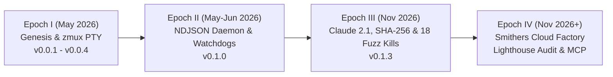

# Mythical History of claude-p

Reconstructed directly from Jujutsu (`jj`) repository history for `smithersai/claude-p` (60 commits, 6 tagged releases, current version `v0.1.3`).

## Epoch I: Genesis and the In-Process PTY

**Period:** 2026-05-13 · Releases: `v0.0.1`, `v0.0.2`, `v0.0.3`, `v0.0.4`

Specified and implemented the Zig 0.15.2 zmux PTY emulator, DEC/XTerm responder, hook FIFO harness, JSONL transcript parser, real-Claude integration tests, and 4-target cross-compile npm packaging.

### Key Turning Points

- [`8c332aa4`](https://github.com/smithersai/claude-p/commit/8c332aa4) Initial Zig scaffold and SPEC.md
- [`814840c2`](https://github.com/smithersai/claude-p/commit/814840c2) zmux-driven session lifecycle and DEC/XTerm query responder
- [`990002da`](https://github.com/smithersai/claude-p/commit/990002da) v0.0.1 cross-compile release pipeline
- [`f14507b7`](https://github.com/smithersai/claude-p/commit/f14507b7) Workspace-trust dialog dismissal and Enter debounce (v0.0.4)

## Epoch II: Multi-Turn Daemon and Community Hardening

**Period:** 2026-05-18 to 2026-06-17 · Releases: `v0.1.0`

Added live transcript streaming, the long-lived NDJSON daemon mode, ping/pong liveness frames, idle-progress watchdogs, CLAUDE_P_PTY_TRACE gating, and community PRs from @madogao.

### Key Turning Points

- [`b79113c7`](https://github.com/smithersai/claude-p/commit/b79113c7) v0.1.0 release with live streaming and musl atomic fix
- [`26e3e7c1`](https://github.com/smithersai/claude-p/commit/26e3e7c1) Long-lived multi-turn claude-p daemon mode
- [`f86ce5bf`](https://github.com/smithersai/claude-p/commit/f86ce5bf) Idle-progress watchdog replacing fixed wall-clock timeout
- [`bb9ee417`](https://github.com/smithersai/claude-p/commit/bb9ee417) NDJSON ping/pong health probes and PTY byte-rate tracing

## Epoch III: Claude Code 2.1, Supply-Chain Trust, and the Fuzzing Crucible

**Period:** 2026-11-22 to 2026-11-24 · Releases: `v0.1.3`

Hardened claude-p for Claude Code 2.1, macOS 1024B TTYHOG chunked paste, SHA-256 checksums.json install trust root, 8 property suites fixing 14 bugs, 3-round multi-model review, coverage-guided Linux fuzzing, zmux v0.2.1, and Starlight docs.

### Key Turning Points

- [`06eb729f`](https://github.com/smithersai/claude-p/commit/06eb729f) Claude Code 2.1 compatibility, PasteChunker, and SHA-256 release pipeline
- [`545e0b11`](https://github.com/smithersai/claude-p/commit/545e0b11) Initial Smithers factory and incremental CI graph
- [`651d3830`](https://github.com/smithersai/claude-p/commit/651d3830) 8 property and fuzz suites slaying 14 edge-case bugs
- [`b4ff6a89`](https://github.com/smithersai/claude-p/commit/b4ff6a89) 3-round adversarial codebase review (Astra + Fable + Neon)
- [`b336615b`](https://github.com/smithersai/claude-p/commit/b336615b) v0.1.3 release pinned to zmux v0.2.1
- [`65d7ad89`](https://github.com/smithersai/claude-p/commit/65d7ad89) Coverage-guided Linux fuzz campaign across every module

## Epoch IV: Smithers Cloud Switchover and Lighthouse Backpressure

**Period:** 2026-11-26 onward

Completed the public coding factory switchover at smithers.sh/smithersai/claude-p with Uphill Lighthouse audit backpressure, shared object-store trust boundaries, personalized maintainer/contributor/viewer UI, Engineering Wiki, Mythical History, Cloud MCP one-time auth, and merge-triggered docs and releases.

### Key Turning Points

- [`919c68bb`](https://github.com/smithersai/claude-p/commit/919c68bb) Uphill continuous metrics, baseline, rules, and Smithers flow
- [`7b7966c7`](https://github.com/smithersai/claude-p/commit/7b7966c7) Zig 0.15.2 fuzzer empty-slot guard, PTY timeout hardening, and scripts/smthrs

## Recent Commit Ledger

| Commit | Date | Tag | Summary |
| --- | --- | --- | --- |
| [`e5dbe23a`](https://github.com/smithersai/claude-p/commit/e5dbe23a) | 2026-11-26 | — | feat(factory): complete Smithers Cloud switchover, 3-audience UI, Lighthouse audit, wiki, mythical history, and MCP sandbox auth |
| [`7b7966c7`](https://github.com/smithersai/claude-p/commit/7b7966c7) | 2026-11-26 | — | fix(ci,fuzz): guard Zig 0.15.2 fuzzer empty-slot crash, harden PTY test timeouts, add scripts/smthrs |
| [`919c68bb`](https://github.com/smithersai/claude-p/commit/919c68bb) | 2026-11-26 | — | chore(uphill): add Uphill continuous metrics, baseline, rules, CI workflow, and Smithers flow |
| [`2fc68ad9`](https://github.com/smithersai/claude-p/commit/2fc68ad9) | 2026-11-24 | — | docs: fix stale daemon turn-range, trace, exit-code, and CI-check references |
| [`7a573ee9`](https://github.com/smithersai/claude-p/commit/7a573ee9) | 2026-11-23 | — | ci(fuzz): run coverage-guided fuzz-linux.sh only on Linux runners |
| [`a8f06c3e`](https://github.com/smithersai/claude-p/commit/a8f06c3e) | 2026-11-23 | — | fix(fuzz): drop empty-string seeds from std.testing.fuzz corpora |
| [`65d7ad89`](https://github.com/smithersai/claude-p/commit/65d7ad89) | 2026-11-23 | — | test(fuzz): coverage-guided fuzzing for every module, Linux campaign runner, and 2 bug fixes |
| [`b336615b`](https://github.com/smithersai/claude-p/commit/b336615b) | 2026-11-23 | v0.1.3 | chore: pin zmux v0.2.1 (#11) |
| [`b4ff6a89`](https://github.com/smithersai/claude-p/commit/b4ff6a89) | 2026-11-23 | — | fix(review): remediate full-codebase review Rounds 1-3 (Astra + Fable + Neon) (#12) |
| [`0905c0fc`](https://github.com/smithersai/claude-p/commit/0905c0fc) | 2026-11-22 | — | fix: deduplicate transcript turns and validate JSONL output |
| [`03301481`](https://github.com/smithersai/claude-p/commit/03301481) | 2026-11-22 | — | docs(readme): link to live GitHub Pages docs near top and in Zig API section |
| [`7574c860`](https://github.com/smithersai/claude-p/commit/7574c860) | 2026-11-22 | — | docs: rewrite README/SPEC/CLAUDE.md, add Starlight docs site, and deploy to GitHub Pages |
| [`651d3830`](https://github.com/smithersai/claude-p/commit/651d3830) | 2026-11-22 | — | test(prop): add comprehensive property & fuzz test suites (8 Astra/Fable suites) and fix 14 bugs found |
| [`545e0b11`](https://github.com/smithersai/claude-p/commit/545e0b11) | 2026-11-22 | — | feat(factory): add local-first Smithers factory and incremental CI for smithers.sh/smithersai/claude-p |
| [`06eb729f`](https://github.com/smithersai/claude-p/commit/06eb729f) | 2026-11-22 | — | feat(v0.1.3): Claude Code 2.1 compatibility, prompt delivery & daemon hardening, CLI parity, CI/SHA256 release pipeline |
| [`d34370fe`](https://github.com/smithersai/claude-p/commit/d34370fe) | 2026-06-17 | — | Merge pull request #4 from madogao/main |
| [`1b5cee72`](https://github.com/smithersai/claude-p/commit/1b5cee72) | 2026-06-14 | — | Merge branch 'smithersai:main' into main |
| [`4a6ecc95`](https://github.com/smithersai/claude-p/commit/4a6ecc95) | 2026-06-12 | — | Merge pull request #1 from madogao/fix/bypass-permissions-dialog |
| [`c37f3844`](https://github.com/smithersai/claude-p/commit/c37f3844) | 2026-06-06 | — | feat(daemon): gate PTY byte-rate trace behind CLAUDE_P_PTY_TRACE |
| [`53919ea1`](https://github.com/smithersai/claude-p/commit/53919ea1) | 2026-06-06 | — | chore(release): v0.1.1 + Linux container cross-build script |
| [`4287c404`](https://github.com/smithersai/claude-p/commit/4287c404) | 2026-06-05 | — | Merge pull request #4 from madogao/feat/pty-byte-rate-trace |
| [`47be2ff1`](https://github.com/smithersai/claude-p/commit/47be2ff1) | 2026-06-03 | — | feat(daemon): periodic PTY byte-rate trace for wedge diagnosis |
| [`ad1c7c41`](https://github.com/smithersai/claude-p/commit/ad1c7c41) | 2026-05-29 | — | Merge pull request #3 from madogao/feat/daemon-health-ping |
| [`bb9ee417`](https://github.com/smithersai/claude-p/commit/bb9ee417) | 2026-05-26 | — | feat(daemon): add ping/pong health-probe frame for liveness detection |
| [`3710a408`](https://github.com/smithersai/claude-p/commit/3710a408) | 2026-05-22 | — | Merge pull request #2 from madogao/fix/bypass-permissions-dialog |
