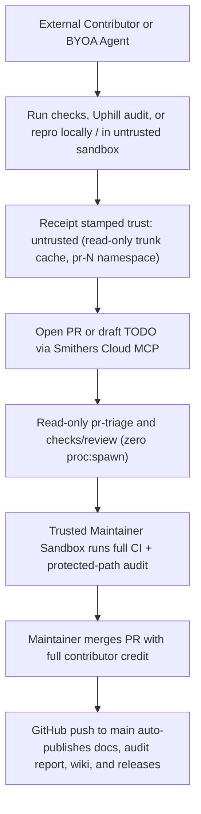

# Contributing, Public TODOs, and Untrusted Execution Policy

## Untrusted Execution Is Encouraged, Never Trusted for Gates

We actively encourage non-maintainers and external agents to run tests, Uphill Lighthouse audits, and repro flows on `smithersai/claude-p`. Most contributors act in good faith, and fast local feedback makes every PR stronger.

To guarantee supply-chain safety without slowing contributors down, `.smithers/trust-policy.json` enforces four non-negotiable rules:
1. **No trunk cache poisoning:** Untrusted PRs and local contributor runs never receive `SMITHERS_CACHE_WRITE_TOKEN` and scope any writes to `pr-<n>` or local disk.
2. **No gate skipping:** Untrusted execution receipts carry `trust: "untrusted"` and never satisfy merge, release, or baseline-update gates.
3. **No untrusted execution in triage:** `pr-triage` and `checks/review` hold zero `proc:spawn:*` capabilities and inspect diffs strictly as untrusted data.
4. **Person-only final authority:** Merging PRs, committing TODOs, publishing releases, and editing secrets are strictly person-only maintainer actions (`roninjin10`).

## Working with Smithers MCP

Read `.smithers/instructions/agent.md` before starting work. Use `scripts/smthrs ci //...` for incremental verification and `node scripts/smithers-auth.mjs` to bootstrap one-time sandbox credentials.

## Related Wiki Pages

- [[smithers-cloud-factory]]
- [[fuzzing-and-verification]]
- [[index]]
