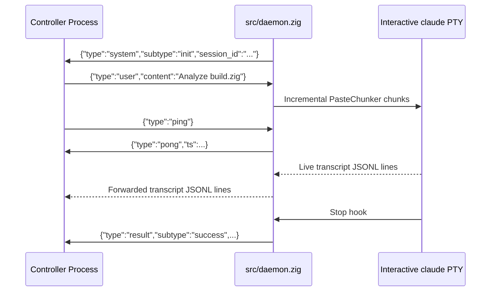

# Multi-Turn NDJSON Daemon Protocol

## Stdin and Stdout Framing

`claude-p daemon --output-format stream-json --verbose` keeps one interactive Claude Code PTY alive across multiple turns. Daemon mode rejects `--output-format text` and `--output-format json`.

- **Inbound frames (stdin NDJSON):** `user`, `ping`, `interrupt`. Blank lines are ignored silently. Queue capacity is bounded at 64 prompts and 64 MiB.
- **Outbound protocol rejections:** Non-turn errors (`invalid_json`, `unsupported_frame_type`, `invalid_user_message`, `unsupported_content_block`, `stdin_line_too_large`, `fifo_line_too_large`, `queue_full`) emit `{"type":"error","error":"<reason>"}`.
- **Outbound turn and session results:** `type:"result"` is reserved strictly for turn-ending and session-ending frames (including `claude_not_found`, `spawn_failed`, `permission_prompt_blocked`, `stop_failure`, and watchdog timeouts).

## Responsiveness and Dual Watchdogs

1. **Incremental paste:** `PendingPaste` in `src/daemon/paste.zig` (re-exported by `src/daemon/turn.zig`) writes one `PasteChunker` chunk per loop tick instead of blocking, so `ping` replies within milliseconds and `interrupt` can abort mid-paste.
2. **Dual watchdogs:** Independent idle-PTY (`--idle-timeout`) and transcript-stall (`--transcript-idle-timeout`) watchdogs in `src/daemon/runtime.zig` monitor `.busy` turns only (never tripping while `.idle`) and exit `124` on stall.
3. **PTY trace gating:** `[pty-trace]` stderr diagnostics remain silent unless `--debug` or `CLAUDE_P_PTY_TRACE` is set.
4. **Shared startup logic:** `src/daemon.zig` delegates dialog handling, paste chunking, and env filtering to `src/driver.zig` (backed by `src/driver/{dialog,paste,env,spawn,runtime}.zig`).

## Related Wiki Pages

- [[index]]
- [[startup-dialogs-and-paste]]
- [[transcript-and-streaming]]
