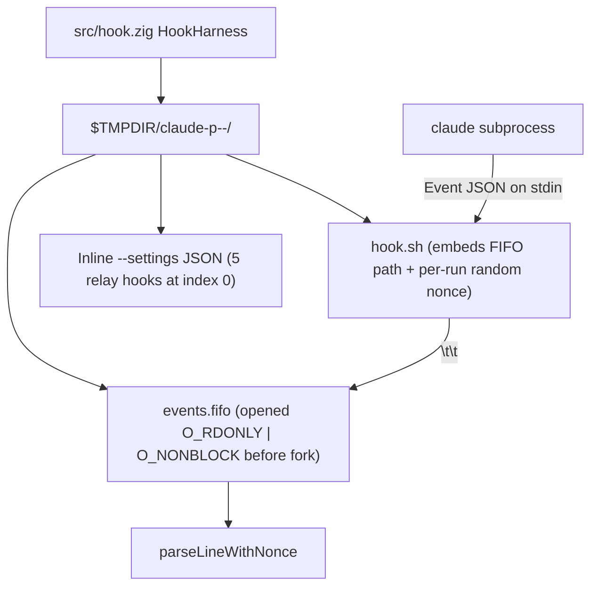

# Nonce-Tagged Hook Relay and Ephemeral FIFO

## Five Core Relay Hooks

`src/hook.zig` generates an inline `--settings` JSON payload registering five relay hooks at index `0` before any user-provided `--extra-hook` entries:
1. `SessionStart`
2. `UserPromptSubmit`
3. `Stop`
4. `StopFailure`
5. `PermissionRequest`

Every run allocates a fresh `$TMPDIR/claude-p-<pid>-<rand>/` directory and removes it in `HookHarness.deinit()`. `~/.claude/` is never read or modified by `claude-p`.

## Nonce Authentication and FIFO Safety

- **Open before spawn:** `events.fifo` is opened with `O_RDONLY | O_NONBLOCK` before spawning `zmux.NativeSession` so `hook.sh` writers never block on startup.
- **No exported FIFO env var:** `CLAUDE_P_FIFO` is never exported into the child environment, and `buildChildEnv` strips any inherited value.
- **Per-run nonce:** `hook.sh` embeds a random nonce and emits `<nonce>\t<event>\t<json>`. Lines failing `parseLineWithNonce` are discarded so stray writes cannot spoof lifecycle events.
- **Safe `--setting-json` merging:** `src/hook.zig` rejects `"disableAllHooks": true` and JSON nesting beyond 128 levels.

## PermissionRequest Fail-Fast

Interactive permission prompts would hang headless automation. On `PermissionRequest`:
- **One-shot mode (`src/driver.zig`):** Fails immediately with `RunError.PermissionPromptBlocked` (exit `2`).
- **Daemon mode (`src/daemon.zig`):** Sends Escape to cancel the prompt, emits `{"type":"result","subtype":"error_during_execution","error":"permission_prompt_blocked",...}`, and returns cleanly to `.idle`.

## Related Wiki Pages

- [[index]]
- [[transcript-and-streaming]]
- [[daemon-protocol]]
