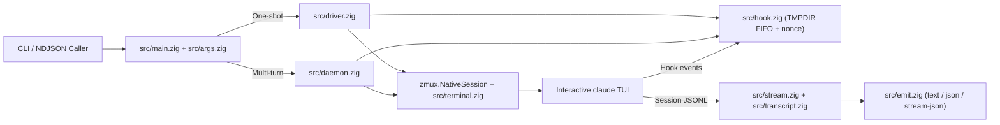

# System Overview and World Model

## Purpose

`claude-p` (v0.1.3) is a Zig 0.15.2 CLI and embeddable library that emulates `claude -p` by driving the interactive `claude` TUI inside an in-process `zmux` PTY session. It observes turn lifecycle events through a per-run nonce-tagged hook FIFO and formats `text`, `json`, or `stream-json` output.

Key contract truths documented in `SPEC.md`:
- `text` and `json` outputs match `claude -p`.
- `stream-json` emits filtered session-transcript JSONL lines (using `sessionId`) followed by a `claude -p`-shaped final `result` envelope. Never call `claude-p` drop-in or wire-compatible.
- `~/.claude/` is never mutated. Every hook script and FIFO lives under `$TMPDIR/claude-p-<pid>-<rand>/` and is deleted on cleanup.

## Module Map

| File | Owns |
| --- | --- |
| `src/main.zig`, `src/stdin.zig` | CLI entry point, bounded stdin composition, signal handling, and exit code mapping (`0`, `1`, `2`, `124`, `128 + sig`) |
| `src/root.zig` | Public Zig library facade and version constant |
| `src/args.zig`, `src/args/flags.zig` | Flag parsing, rejected print-only flags, boolean passthrough table, cross-flag rules, and embedded help text |
| `src/terminal.zig` | Stateful `DecDecoder` responding to DA1, DA2, DSR, XTVERSION, and 18t queries |
| `src/hook.zig`, `src/hook/settings.zig` | Inline `--settings` generation, FIFO setup, nonce-tagged `hook.sh`, and `--setting-json` validation |
| `src/driver.zig`, `src/driver/{spawn,env,stop_scan,watchdog,paste,dialog,diag,runtime,finalizer,session}.zig` | One-shot execution DAG: spawn and env filtering, startup dialog FSM, `PasteChunker`, provisional Stop scanner, bounded diagnostics, watchdogs, and finalizer |
| `src/daemon.zig`, `src/daemon/{protocol,queue,paste,turn,runtime}.zig` | Long-lived NDJSON daemon DAG (`user`, `ping`, `interrupt`), bounded prompt queue, incremental `PendingPaste`, turn transcript cursor, and dual watchdogs |
| `src/transcript.zig`, `src/transcript/file.zig` | Symlink-safe transcript opening and offset-scoped JSONL parser with `uuid` and `message.id` deduplication |
| `src/stream.zig` | `pread`-based line-buffered tailer with 16 MiB partial-line cap |
| `src/emit.zig` | `text`, `json`, and `stream-json` output encoders and error helpers |

## Related Wiki Pages

- [[pty-and-zmux]]
- [[startup-dialogs-and-paste]]
- [[hook-relay-and-fifo]]
- [[transcript-and-streaming]]
- [[daemon-protocol]]
- [[smithers-cloud-factory]]
