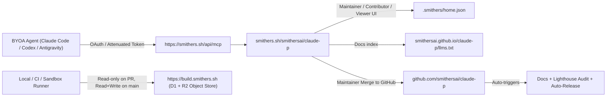

# Smithers Cloud Factory, Object Store, and Cloud MCP Auth

## Shared Smithers Cloud Object Store

`.smithers/WORKSPACE.ts` binds every incremental Zig, JS, docs, and audit build target in `.smithers/PACKAGE.ts` to the shared Smithers Cloud object store at `https://build.smithers.sh` (`Smithers-Cache-Contract: result-only-v1`, backed by Cloudflare D1 + R2).

Credential split enforced in `.smithers/WORKSPACE.ts` and `.smithers/trust-policy.json`:
- `SMITHERS_CACHE_READ_TOKEN`: Available to PR jobs and contributor runs for fast cache hits.
- `SMITHERS_CACHE_WRITE_TOKEN`: Scoped strictly to the `cache-publish` GitHub Environment on `refs/heads/main` and trusted maintainer sandboxes.

## Personalized 3-Audience Factory UI

`.smithers/FACTORY.ts` projects `.smithers/home.json` with `contributors: "role"` and three distinct sections validated against `@smthrs/views`:
1. **Maintainer (`roninjin10`):** Command center with `New branch` (`b`), open issues/TODOs, active changeset stack, live factory runs, operations flows, and health links.
2. **Contributor (contributors who have contributed):** Contributor workbench with prompt composer, changeset stack, runnable flows, quick app cards, setup commands, and untrusted execution rules.
3. **Everyone (public viewers):** Product showcase hero with `npx claude-p`, live CLI and daemon examples, stats bar, architecture cards, public coding factory links (Lighthouse Audit, Wiki, Mythical History, Cloud MCP), and release history.

## Authenticated Cloud MCP and One-Time Sandbox Auth

Agents connect to `https://smithers.sh/api/mcp` (or local `scripts/smthrs --mcp`) to read docs/files, create issues and comments, draft public TODOs, inspect PRs, and attach verified artifacts.

`scripts/smithers-auth.mjs` (and `.smithers/flows/sandbox-auth/flow.ts`) mints and prints short-lived, attenuated one-time credentials for sandboxes and BYOA agents (scoped gateway tokens via `smthrs token mint`, single-use WS tickets, and repo-scoped Cloud MCP OAuth/bearer instructions) without ever exposing master `SMITHERS_TOKEN` secrets or browser cookies.

## Related Wiki Pages

- [[index]]
- [[contributing-and-triage]]
- [[supply-chain-and-releases]]
