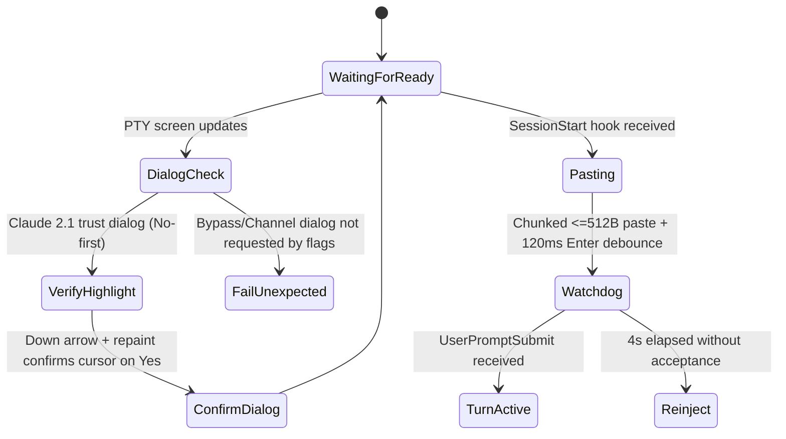

# Startup Dialog FSM and macOS TTYHOG Safe Paste

## Intent-Gated Startup Dialogs

`src/driver.zig` owns `maybeHandleStartupDialogs` and `dialogConfirmAllowed`, which `src/daemon.zig` also calls directly so startup behavior is fixed once for both modes:
- **Claude Code 2.1 trust dialog:** Defaults to `"No, exit"`. The state machine sends a downward navigation key and waits for a screen repaint confirming the `❯` marker sits on the affirmative option before sending `\r`.
- **Bypass-permissions and development-channels dialogs:** Only confirmed when the caller explicitly passed matching CLI flags (`--dangerously-skip-permissions`, `--permission-mode bypassPermissions`, or `--dangerously-load-development-channels`). Otherwise `claude-p` sends no key and exits `2` (`UnexpectedStartupDialog`).

## macOS TTYHOG 1024-Byte Paste Safety

macOS caps canonical PTY input queues (`TTYHOG`) at 1024 bytes. Writing a large prompt in a single write silently truncates or drops bytes.

`PasteChunker` in `src/driver.zig` enforces four invariants:
1. Splits prompts into UTF-8-safe chunks of at most 512 bytes (never slicing mid-codepoint).
2. Neutralizes embedded `\x1b[201~` sequences so untrusted prompt text cannot break out of bracketed paste mode.
3. Paces chunks with 8 ms gaps and waits 120 ms before sending Enter (`\r`).
4. In daemon mode (`src/daemon.zig`), `PendingPaste` drains one chunk per event-loop tick so `ping` and `interrupt` frames stay responsive even during a 64 KiB paste.

## Targeted Environment Filtering

`shouldStripChildEnv` in `src/driver.zig` removes only nested-session markers (`CLAUDECODE`, `AI_AGENT`, `CLAUDE_CODE_ENTRYPOINT`, `CLAUDE_CODE_SSE_PORT`, `CLAUDE_CODE_CHILD_SESSION`, `CLAUDE_CODE_SESSION_ID`, and prefixes `CLAUDE_CODE_SESSION_`, `CLAUDE_CODE_PARENT_`, `CLAUDE_CODE_SUBAGENT_`) plus any inherited `CLAUDE_P_FIFO`. It preserves `CLAUDE_CODE_OAUTH_TOKEN`, Bedrock, Vertex, and Foundry credentials.

## Related Wiki Pages

- [[pty-and-zmux]]
- [[daemon-protocol]]
- [[fuzzing-and-verification]]
