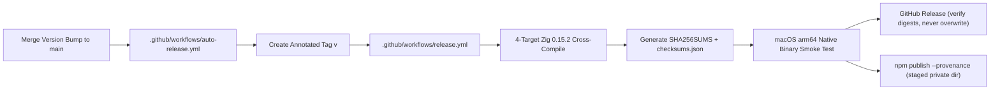

# Supply-Chain Trust Root and Automated Releases

## Version Lockstep

`package.json`, `build.zig.zon`, and `src/root.zig` must always agree on the exact version string. `node scripts/publish.mjs --check-versions` enforces this invariant in local checks, Uphill, CI, and release workflows.

## Installer Trust Root (`scripts/install.js`)

`claude-p` ships zero runtime npm dependencies. `bin/claude-p.js` launches `prebuilt/<platform>-<arch>/claude-p` and forwards `SIGINT`, `SIGTERM`, and `SIGHUP`.

During `postinstall`, `scripts/install.js` enforces strict integrity checks:
1. Bundled `checksums.json` (staged exclusively inside a private publish directory by `scripts/publish.mjs`, never committed to repo root) is the primary trust root.
2. When `checksums.json` is absent, `SHA256SUMS` from the matching GitHub Release is mandatory for `>= 0.1.3` (HTTP 404 is a hard failure).
3. An existing binary is reused only on an exact `binSha256` match and never through a symlinked directory. Mismatched binaries are unlinked before download.
4. Every integrity or local filesystem error exits `1`. Only network connectivity errors warn and exit `0` unless `CLAUDE_P_STRICT_INSTALL=1`.

## Merge-Triggered Release Automation

Merging a version bump into `main` from Smithers Cloud automatically triggers `.github/workflows/auto-release.yml`, which verifies version lockstep, tests, and audit gates before creating tag `v<version>`. That tag invokes `.github/workflows/release.yml` (cross-compiling `aarch64-macos`, `x86_64-macos`, `x86_64-linux-musl`, and `aarch64-linux-musl`, verifying the macOS binary, publishing the GitHub Release, and running `npm publish --provenance`). Maintainers can also drive the durable `.smithers/flows/release/flow.ts` flow with `HumanTask` approval.

## Related Wiki Pages

- [[smithers-cloud-factory]]
- [[fuzzing-and-verification]]
