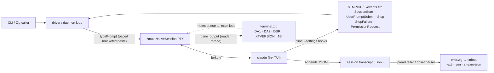

# claude-p

> **Use at your own risk.** This package and repository exist for
> **educational purposes** and demonstrates why client-side restrictions
> on how a product is used are fundamentally unenforceable.

A `claude -p` emulator that drives the interactive `claude` UI inside an
in-process [zmux][zmux] PTY session. `text` and `json` output follow
`claude -p`'s result shape; `stream-json` emits Claude Code
session-transcript lines plus a `claude -p`-shaped `result` envelope (see
[Output formats](#output-formats)).

Built publicly on [Smithers Cloud][factory] ([Docs][docs] · [Lighthouse Audit][audit] · [Engineering Wiki][wiki] · [Mythical History][history] · [Smithers][smithers]).

[zmux]: https://github.com/smithersai/zmux
[smithers]: https://github.com/smithersai/smithers
[factory]: https://smithers.sh/smithersai/claude-p
[docs]: https://smithersai.github.io/claude-p/
[audit]: https://smithersai.github.io/claude-p/audit/
[wiki]: https://smithersai.github.io/claude-p/wiki/
[history]: https://smithersai.github.io/claude-p/history/

---

## Quick start

Requires `claude` on `$PATH`, Node `>= 18` (for `npx`), and macOS or Linux (`arm64` or `x64`).

```bash
# Plain text (default)
npx claude-p "Reply with the single word OK."

# Pipe stdin and return a structured JSON result
git diff HEAD~1 | npx claude-p --output-format json "Summarize this diff."

# Stream session-transcript JSONL live, then a result envelope (--verbose required)
npx claude-p --output-format stream-json --verbose "Audit src/" | jq .

# Long-lived multi-turn daemon over stdin/stdout NDJSON
printf '%s\n' \
  '{"type":"user","message":{"role":"user","content":"Summarize this repo."}}' \
  | npx claude-p daemon
```

On install, `scripts/install.js` fetches the prebuilt binary from GitHub Releases and verifies its SHA-256 digest before writing it:

- **npm installs** verify against the `checksums.json` bundled in the npm tarball, written by `scripts/publish.mjs` and covered by npm provenance. It is the only trust root: a missing entry or a mismatch fails the install with exit `1`. `SHA256SUMS` is not consulted.
- **Source checkouts** (no `checksums.json`) verify against the release's `SHA256SUMS`. From `v0.1.3` on, a missing `SHA256SUMS` (HTTP 404) fails the install; it never degrades to an unverified binary. `CLAUDE_P_REQUIRE_CHECKSUM=1` also requires it for older versions.
- **An existing binary** is reused only when `checksums.json` records its `binSha256` and the file matches exactly. A mismatched file is deleted before the download starts, then a verified binary is atomically renamed into place. A `checksums.json` without both digests for the platform fails before any download.

Downloads use `https` only, from `github.com` and `*.githubusercontent.com`, with at most 5 redirects, one overall 30 s deadline, and 32 MiB compressed / 64 MiB decompressed caps. Symlinked package or `prebuilt/` directories are refused, and the binary is written through an exclusively created staging file and renamed into place.

| Install outcome | Exit |
| --- | --- |
| Verified binary installed or reused | `0` |
| Checksum or integrity failure | `1` (always) |
| Local filesystem error (`ENOSPC`, `EACCES`, `EPERM`, `EROFS`) or unsafe path | `1` (always) |
| Connectivity failure (DNS, offline, HTTP error, timeout) | `0` with a warning, or `1` when `CLAUDE_P_STRICT_INSTALL=1` |
| `CLAUDE_P_SKIP_DOWNLOAD=1` | `0`, download skipped |

Behind an HTTP(S) proxy, set `NODE_USE_ENV_PROXY=1` (Node `>= 22.21` or `>= 24`) with `HTTPS_PROXY`, or set `CLAUDE_P_SKIP_DOWNLOAD=1` and supply the binary yourself.

---

## Architecture

`claude-p` never modifies `~/.claude/`. For each run it spawns `claude` on a real PTY, answers the terminal queries Ink issues at boot, passes inline `--settings` hooks wired to a per-run FIFO, and reads the session transcript JSONL.



1. **Real PTY.** `zmux.NativeSession` forks `claude` onto a real PTY (`openpty`/`forkpty`) with a background reader thread. Ink refuses to start on plain pipes.
2. **Terminal handshake.** `terminal.DecDecoder` scans PTY output, carrying split sequences across reads, and replies to five DEC/XTerm queries (`DA1`, `DA2`, `DSR`, `XTVERSION`, `18t`; the window-size reply reports the configured rows and columns). Without replies, Ink hangs at startup.
3. **Hook relay.** Inline `--settings` registers `hook.sh` for `SessionStart`, `UserPromptSubmit`, `Stop`, `StopFailure`, and `PermissionRequest`. The script embeds the FIFO path and a per-run nonce and writes `<nonce>\t<event>\t<json>` lines; lines with another nonce are dropped. No `CLAUDE_P_FIFO` variable is exported to `claude`. A `PermissionRequest` means a permission prompt no one can answer, so one-shot mode fails at once with `PermissionPromptBlocked` (exit `2`).
4. **Startup dialogs.** Before `SessionStart`, the driver answers the workspace-trust modal, verifying the `❯` cursor sits on the affirmative option before pressing Enter. It answers the bypass-permissions modal only when this run passed `--dangerously-skip-permissions` or `--permission-mode bypassPermissions`, and the development-channels modal only with `--dangerously-load-development-channels`. Any other such modal fails the run with `UnexpectedStartupDialog` (exit `2`) without a key press.
5. **Paced bracketed paste.** After `SessionStart`, one-shot mode pastes the prompt inside `\x1b[200~`…`\x1b[201~` in UTF-8-safe chunks of at most 512 bytes spaced 8 ms apart (staying under macOS's 1024-byte `TTYHOG`), pauses 120 ms for Ink's Enter debounce, and sends `\r`.
6. **Delivery check & completion.** One-shot mode verifies acceptance via `UserPromptSubmit` (including a truncation check for prompts over 64 non-whitespace bytes) or transcript growth. If neither arrives within 4 s, it sends `Ctrl-U` and retries up to 4 injections total. When `Stop` fires, the wrapper confirms on `stop_hook_summary` (`preventedContinuation: false`) or after a fallback confirmation window (150 ms, or 2000 ms when `--extra-hook Stop=` is set; a blocking Stop hook's continuation or later `Stop` supersedes the first), then parses the transcript (retrying while Claude flushes, falling back to `last_assistant_message`), prints the result, and terminates the child. Records repeated by `uuid` are skipped, and usage counts each `message.id` once. When `StopFailure` fires, or an assistant entry has `isApiErrorMessage: true`, the result has `is_error: true` and `subtype: "error_during_execution"` (exit `1`).

---

## Daemon mode

`claude-p daemon [OPTIONS]` keeps one interactive `claude` session alive across multiple turns. It speaks newline-delimited JSON (NDJSON) on stdin and stdout. The stdin `user` frame matches `claude -p --input-format stream-json`; stdout follows the same transcript-lines-plus-`result` contract as one-shot `stream-json`, not native `claude -p` events.

### Stdin frames

| Frame | Effect |
| --- | --- |
| `{"type":"user","message":{"role":"user","content":"…"}}` | Queues a prompt and submits it when idle. Also accepts an array of `{"type":"text","text":"…"}` blocks or top-level `{"type":"user","content":"…"}`. The queue holds at most 64 prompts and 64 MiB; beyond that the frame gets `queue_full`. |
| `{"type":"ping"}` | Answered immediately by the main event loop in any state with `{"type":"pong","ts":<unix_ms>}`. |
| `{"type":"interrupt"}` | While busy: sends Escape. If `Stop` arrives within 1.5 s the turn ends normally; otherwise a `result` with `"subtype":"interrupted"` (`is_error: false`) is emitted and the session stays open. Ignored when idle. |

Blank and whitespace-only lines are ignored silently. A rejected line gets a `{"type":"error","error":"<reason>"}` protocol frame and the session continues: `invalid_json` (not valid JSON), `unsupported_frame_type` (unknown or missing `type`), `invalid_user_message` (no text), `unsupported_content_block` (a non-text block), `stdin_line_too_large` (over 16 MiB), or `queue_full`. Closing stdin (EOF) drains the active turn and any queued prompts, terminates `claude`, and exits `0`; EOF before `SessionStart` with nothing queued also exits `0`.

### Stdout frames

| Frame | Emitted when |
| --- | --- |
| `{"type":"system","subtype":"init","session_id":"…"}` | Once, when `SessionStart` fires. |
| Raw transcript JSONL lines | Live, as `claude` flushes them (`--resume`/`--continue` skips to existing EOF first). |
| `{"type":"result", ...}` | On each `Stop`, scoped to the transcript byte range of that turn. |
| `{"type":"error","error":"<reason>"}` | Protocol rejection of one stdin or FIFO line (`invalid_json`, `unsupported_frame_type`, `invalid_user_message`, `unsupported_content_block`, `stdin_line_too_large`, `fifo_line_too_large`, `queue_full`). No turn ends. |
| `{"type":"result","subtype":"error"\|"error_during_execution"\|"interrupted","error":"<reason>", ...}` | Turn-ending or session-ending failures only: failed turns (`prompt_not_accepted`, `stop_failure`, `result_unavailable`, `permission_prompt_blocked`), interrupts, startup failures (`claude_not_found`, `spawn_failed`, with a `stage`), and fatal exits (`child_exited`, `unexpected_startup_dialog`, `prompt_truncated`, the three timeouts). Tell them from turn results by the `error` field. |
| `{"type":"pong","ts":<unix_ms>}` | Immediately on each `ping`. |

### Watchdogs and PTY telemetry

Every timeout writes one error frame and exits `124`.

- `--timeout <sec>` (default `300`, `0` disables): deadline for initial `SessionStart` (`session_start_timeout`).
- `--idle-timeout <sec>` (default `180`, `0` disables): kills the session if busy with no PTY output for that long (`idle_timeout`). Resets on idle → busy and never fires while idle.
- `--transcript-idle-timeout <sec>` (default `600`, `0` disables): kills the session if busy and the transcript stops growing for that long (`transcript_stalled`). An animated spinner does not reset it. One-shot mode applies the same flag while awaiting `Stop` (`TranscriptStalled`, exit `124`).
- `PermissionRequest` while busy: the daemon sends Escape, emits a `type:"result"` frame with `"subtype":"error_during_execution"` and `"error":"permission_prompt_blocked"`, and returns to idle.
- `[pty-trace]` stderr diagnostics are off by default. `--debug` turns them on every 60 s; `CLAUDE_P_PTY_TRACE=<seconds>` sets the interval, and `0`, `off`, `false`, or `no` turns them off.

---

## CLI reference

```text
claude-p [OPTIONS] [PROMPT]
claude-p daemon [OPTIONS]
```

If `PROMPT` is omitted in one-shot mode, `claude-p` reads from `--input-file` or piped stdin (up to 16 MiB). With both `PROMPT` and piped stdin, it sends `<stdin>\n\n<PROMPT>`, as `claude -p` does; if stdin yields nothing within 3 s it warns and sends `PROMPT` alone. Every option that takes one value also accepts `--option=<value>`.

| Flag | Default | Description |
| --- | --- | --- |
| `--output-format <fmt>` | `text` | `text`, `json`, or `stream-json`. `stream-json` requires `--verbose` in one-shot mode. |
| `--model <name>` | — | Forwarded to `claude --model`. |
| `--allowedTools`, `--allowed-tools <rule>...` | — | Permission allow rules. Repeatable and variadic: every rule is kept and forwarded in order. `--allowedTools=<rule>` takes one. Put `PROMPT` first or after `--`. |
| `--disallowedTools`, `--disallowed-tools <rule>...` | — | Permission deny rules. Same rules as `--allowedTools`. |
| `--permission-mode <mode>` | — | `acceptEdits`, `auto`, `bypassPermissions`, `default`, `dontAsk`, `plan`, etc. |
| `--dangerously-skip-permissions` | `false` | Bypass permission prompts. |
| `--system-prompt <text>` | — | Override the default system prompt. |
| `--append-system-prompt <text>` | — | Append to the default system prompt. |
| `--add-dir <dir>...` | — | Additional directories (repeatable, variadic). |
| `--mcp-config <cfg>...` | — | MCP config paths or JSON (repeatable, variadic). |
| `--setting-sources <list>` | — | Comma-separated setting sources (`user,project,local`). |
| `--resume`, `-r <id>` | — | Resume a prior session by ID. |
| `--continue`, `-c` | `false` | Continue the most recent session. |
| `--session-id <uuid>` | — | Force a specific session UUID. |
| `-n`, `--name <name>` | — | Session display name (one value), forwarded to `claude`. |
| `--cwd <path>` | current dir | Working directory for `claude`. |
| `--input-file <path>` | — | Read prompt from file (one-shot mode). |
| `--verbose` | `false` | Forwarded to `claude`; required with `--output-format stream-json`. |
| `--timeout <sec>` | `300` | One-shot wall-time cap, or daemon `SessionStart` deadline. |
| `--idle-timeout <sec>` | `180` | Daemon busy-turn PTY silence watchdog (`0` disables). |
| `--transcript-idle-timeout <sec>` | `600` | Transcript growth watchdog in both modes (`0` disables): one-shot while awaiting `Stop` (`TranscriptStalled`), daemon while busy (`transcript_stalled`). Exit `124`. |
| `--extra-hook <Event>=<cmd>` | — | Add a hook command to the generated `--settings` (repeatable). |
| `--setting-json <json>` | — | JSON object merged into the generated `--settings` (the `hooks` key is excluded). |
| `--debug` | `false` | Emit timestamped driver diagnostics to stderr; in daemon mode also enables `[pty-trace]`. |
| `--` | — | End of options; remaining token goes to `PROMPT`. |
| `-h`, `--help` | — | Print help and exit `0`. |
| `-v`, `--version` | — | Print `claude-p 0.1.3` and exit `0`. |

**Forwarded and rejected flags:** Unrecognized flags are forwarded verbatim to `claude` (known boolean flags such as `--fork-session` and `--strict-mcp-config` do not consume the following argument). These flags are rejected with exit code `2`, in both the bare and `<flag>=<value>` forms:

- `-p` / `--print`: `claude-p` emulates print mode.
- `--settings`: `claude-p` injects its own inline `--settings` for hooks. Use `--extra-hook` or `--setting-json` instead.
- `--bare` / `--safe-mode`: Claude Code skips `--settings` hooks under them, so the relay hooks would never fire.
- `--no-session-persistence`: stops `claude` writing the transcript that `claude-p` reads.
- `--input-format`, `--json-schema`, `--max-budget-usd`: print-mode-only; the interactive session would silently ignore them.
- `--max-turns`, `--fallback-model`, `--include-partial-messages`, `--forward-subagent-text`, `--replay-user-messages`, `--verbose-thinking`: print-mode-only; `claude-p` neither enforces a turn cap or fallback model nor emits those stream events. Library callers get `RunError.InvalidOptions`.
- `--output-format text` or `json` in daemon mode: the daemon always writes stream-json.

`--setting-json` is also refused (exit `2`, `InvalidExtraSettings`) when it is not a JSON object, nests deeper than 128 levels, or sets `"disableAllHooks": true`.

---

## Output formats

| `--output-format` | Stdout |
| --- | --- |
| `text` (default) | Final assistant text and `\n`. |
| `json` | One `claude -p`-shaped `result` envelope: `type`, `subtype`, `session_id`, `result`, `is_error`, `duration_ms`, `duration_api_ms`, `num_turns`, `total_cost_usd`, `usage`, `permission_denials`. |
| `stream-json` | Every JSON line Claude Code appends to its session transcript during the run (transcript `result` lines excluded), then the `result` envelope. |

`stream-json` is not wire-compatible with `claude -p --output-format stream-json`. Event lines use Claude Code's transcript schema (for example `sessionId`, not `session_id`), there is no `system`/`init` line in one-shot mode, and line types follow the transcript. Read `session_id` from the final `result` line.

---

## Exit codes

The native binary sets every code; `bin/claude-p.js` passes it through.

| Code | Meaning |
| --- | --- |
| `0` | Success (`is_error: false`), or daemon shut down cleanly. |
| `1` | Assistant returned an error (`is_error: true`), including `StopFailure`. |
| `2` | Invalid or rejected arguments, empty prompt, missing binary, or a run error: `PermissionPromptBlocked`, `InvalidOptions`, `PromptNotAccepted`, `PromptTruncated`, `TranscriptUnavailable`, `SpawnFailed`, `InvalidExtraSettings`, `InvalidCwd`, `UnexpectedStartupDialog`, or `Interrupted` without a caught signal. Daemon `claude_not_found`, `spawn_failed`, `child_exited`, `unexpected_startup_dialog`, and `prompt_truncated` also exit `2`. |
| `124` | Timeout: `SessionStartTimeout`, `StopTimeout`, or `TranscriptStalled` (one-shot); `session_start_timeout`, `idle_timeout`, or `transcript_stalled` (daemon). |
| `128 + sig` | `SIGINT`, `SIGTERM`, or `SIGHUP`: the binary cleans up and exits `128 + sig` (`130` for `SIGINT`). A duplicate signal within 2 s is ignored, so a process-group `SIGINT` through `bin/claude-p.js` still cleans up. |

Failure messages on stderr carry the stage, cause, status, timings, and PTY byte count only. The recent-screen excerpt, which can contain prompt or tool text, appears only with `--debug` or `CLAUDE_P_DEBUG_SCREEN=1`.

---

## As a Zig library

Requires Zig **0.15.2** (matching `zmux`'s `comptime` version pin).

```bash
zig fetch --save=claude_p git+https://github.com/smithersai/claude-p
```

```zig
const std = @import("std");
const claude_p = @import("claude_p");

pub fn main() !void {
    var gpa: std.heap.GeneralPurposeAllocator(.{}) = .{};
    defer _ = gpa.deinit();
    const alloc = gpa.allocator();

    var result = try claude_p.run(alloc, .{
        .prompt = "What is the capital of France?",
        .output_format = .text,
        .skip_permissions = true,
    });
    defer result.deinit(alloc);

    std.debug.print("{s}\n", .{result.summary.final_text});
}
```

The Zig API (`claude_p.Options`) also exposes hook/settings composition via `extra_hooks` (`[]const hook.ExtraHook`, the `--extra-hook` flag) and `extra_settings_json` (`?[]const u8`, the `--setting-json` flag), live streaming via `stream_writer`, and multi-turn driving via `claude_p.daemon.run`. See the [Zig Library API Reference](https://smithersai.github.io/claude-p/reference/zig-api/) for every field and error.

---

## Build and test from source

```bash
git clone https://github.com/smithersai/claude-p
cd claude-p
zig build -Doptimize=ReleaseSafe   # requires Zig 0.15.2
zig build test --summary all       # unit, property & fuzz-corpus tests (no external claude needed)
./scripts/fuzz-linux.sh            # Linux: coverage-guided fuzzing of every target
CLAUDE_P_E2E=1 zig build test-integration --summary all  # real-claude end-to-end tests
node --test .smithers/tests/install-checksum.test.mjs tests/prop/js_supplychain_prop.mjs
```

`--summary all` prints the current test counts.

### Releases

`scripts/publish.mjs` refuses to build or attach assets unless the local tag's peeled commit equals `HEAD` and the remote tag, if it exists, peels to the same commit. On reruns it verifies every existing release asset by digest against `SHA256SUMS` and `checksums.json` before reporting success, and uploads only missing assets. It stages the npm package in a private temporary directory with the generated `checksums.json`, checks the packed tarball holds all four platform digests at the `package.json` version, and publishes from there. It never writes `checksums.json` into the repository root.

---

## Caveats

- **macOS and Linux only.** No Windows support (`forkpty` is POSIX-only).
- **Requires `claude` on `$PATH`.** `claude-p` drives the real installed binary.
- **Per-message streaming, not per-token.** `--output-format stream-json --verbose` tails the session JSONL as `claude` flushes complete lines; token-by-token deltas require native `claude -p --include-partial-messages`.
- **Startup overhead.** Expect ~50–200 ms over native `claude -p` for PTY allocation and Ink boot.
- **Upstream coupling.** `claude` is not designed to be driven through its TUI. New startup dialogs, terminal probes, or hook schema changes in future Claude Code releases can break the wrapper; failures surface explicitly rather than silently.

---

## Documentation

- **Documentation site:** <https://smithersai.github.io/claude-p/> (Starlight source in [`docs/`](./docs); preview locally with `cd docs && npm install && npm run dev`).
- **Technical specification:** [`SPEC.md`](./SPEC.md) — module contracts, wire formats, state machines, and test matrix.
- **Agent guide:** [`CLAUDE.md`](./CLAUDE.md) — invariants and gotchas for contributors and coding agents.

## License

MIT. See [`LICENSE`](./LICENSE).
