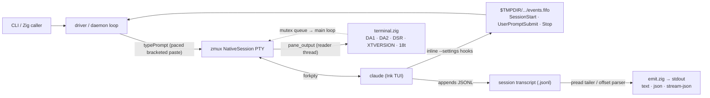

# claude-p

> **Use at your own risk.** This package and repository exist for
> **educational purposes** and demonstrates why client-side restrictions
> on how a product is used are fundamentally unenforceable.

A drop-in replacement for `claude -p` that drives the interactive
`claude` UI inside an in-process [zmux][zmux] PTY session.

Built using [smithers][smithers] self-improving harness.

**Docs:** [smithersai.github.io/claude-p][docs] · [Getting Started][docs-start] · [Tutorials][docs-tutorials] · [How It Works][docs-arch] · [CLI Reference][docs-cli]

[zmux]: https://github.com/smithersai/zmux
[smithers]: https://github.com/smithersai/smithers
[docs]: https://smithersai.github.io/claude-p/
[docs-start]: https://smithersai.github.io/claude-p/getting-started/
[docs-tutorials]: https://smithersai.github.io/claude-p/tutorials/first-automation/
[docs-arch]: https://smithersai.github.io/claude-p/internals/architecture/
[docs-cli]: https://smithersai.github.io/claude-p/reference/cli/

---

## Quick start

Requires `claude` on `$PATH`, Node `>= 18` (for `npx`), and macOS or Linux (`arm64` or `x64`).

```bash
# Plain text (default)
npx claude-p "Reply with the single word OK."

# Pipe stdin and return a structured JSON result
git diff HEAD~1 | npx claude-p --output-format json "Summarize this diff."

# Stream transcript JSONL live as messages flush (--verbose required)
npx claude-p --output-format stream-json --verbose "Audit src/" | jq .

# Long-lived multi-turn daemon over stdin/stdout NDJSON
printf '%s\n' \
  '{"type":"user","message":{"role":"user","content":"Summarize this repo."}}' \
  | npx claude-p daemon
```

On install, `scripts/install.js` fetches the prebuilt binary from GitHub Releases and verifies its SHA-256 digest against `SHA256SUMS`. Set `CLAUDE_P_REQUIRE_CHECKSUM=1` to fail hard if a release lacks `SHA256SUMS`, or `CLAUDE_P_SKIP_DOWNLOAD=1` to skip downloading.

| Mode | Command / API | Best for |
| --- | --- | --- |
| One-shot CLI | `claude-p [OPTIONS] [PROMPT]` | Shell scripts, CI steps, git hooks (`text`, `json`, `stream-json`). |
| Multi-turn daemon | `claude-p daemon [OPTIONS]` | Long-lived controllers over NDJSON (`user`, `ping`, `interrupt`). |
| Zig library | `claude_p.run()` / `claude_p.daemon.run()` | Native Zig 0.15.2 programs with direct `std.Io.Writer` streaming. |

---

## Architecture

`claude-p` never modifies `~/.claude/`. For each run it spawns `claude` on a real PTY, answers the terminal queries Ink issues at boot, passes inline `--settings` hooks wired to a per-run FIFO, and reads the session transcript JSONL.



1. `zmux.NativeSession` forks `claude` onto a real `openpty`/`forkpty` PTY with a background reader thread (Ink exits on plain pipes).
2. `src/terminal.zig` scans incoming PTY output and replies to five DEC/XTerm probes (`DA1`, `DA2`, `DSR`, `XTVERSION`, `18t`) so Ink boots without hanging.
3. Before `SessionStart`, both one-shot and daemon modes run the Claude Code 2.1 dialog state machine—verifying the `❯` cursor landed on the affirmative option before sending Enter.
4. After `SessionStart`, both modes paste prompts inside `\x1b[200~`…`\x1b[201~` in UTF-8-safe chunks of at most 512 bytes spaced 8 ms apart (safe under macOS's 1024-byte `TTYHOG`), pause 120 ms for Ink's Enter debounce, and send `\r`.
5. One-shot mode verifies acceptance via `UserPromptSubmit` (including truncation checks above 64 non-whitespace bytes) or transcript growth, retrying with `Ctrl-U` after 4 s up to 4 attempts. When `Stop` fires, it parses the transcript (retrying while Claude flushes, falling back to `last_assistant_message`), prints stdout, and terminates the child.

---

## Daemon mode

`claude-p daemon [OPTIONS]` keeps one interactive `claude` session alive across multiple turns. It speaks newline-delimited JSON (NDJSON) on stdin and stdout, compatible with `claude -p --input-format stream-json --output-format stream-json --verbose`.

### Stdin frames

| Frame | Effect |
| --- | --- |
| `{"type":"user","message":{"role":"user","content":"…"}}` | Queues a prompt and submits it via paced bracketed paste when idle. Also accepts an array of `{"type":"text","text":"…"}` blocks or top-level `{"type":"user","content":"…"}`. |
| `{"type":"ping"}` | Answered immediately by the main event loop in any state with `{"type":"pong","ts":<unix_ms>}`. |
| `{"type":"interrupt"}` | While busy, sends Escape (`\x1b`) and waits up to 1.5 s for `Stop`. If none arrives, emits a `result` frame (`subtype: "interrupted"`, `is_error: false`) and returns to idle with the session open. |

Closing stdin (EOF) drains the active turn and any queued prompts, terminates `claude`, and exits `0`.

### Stdout frames

| Frame | Emitted when |
| --- | --- |
| `{"type":"system","subtype":"init","session_id":"…"}` | Once, when `SessionStart` fires. |
| Raw transcript JSONL lines | Live, as `claude` flushes them (`--resume`/`--continue` skips to existing EOF first). |
| `{"type":"result", ...}` | On each `Stop`, scoped to the transcript byte range of that turn. |
| `{"type":"pong","ts":<unix_ms>}` | Immediately on each `ping`. |
| `{"type":"result","subtype":"interrupted","error":"interrupted","is_error":false,...}` | After interrupting a busy turn when no `Stop` lands in 1.5 s. |
| `{"type":"result","subtype":"error","error":"<reason>","is_error":true,...}` | Before exiting on a watchdog timeout (`session_start_timeout`, `idle_timeout`, `transcript_stalled`). |

### Watchdogs and PTY telemetry

- `--timeout <sec>` (default `300`): deadline for initial `SessionStart` (`session_start_timeout`, exit `2`).
- `--idle-timeout <sec>` (default `180`, `0` disables): kills the session if busy with no PTY output (`idle_timeout`, exit `124`).
- `--transcript-idle-timeout <sec>` (default `600`, `0` disables): spinner-immune watchdog that kills the session if busy with no new transcript bytes (`transcript_stalled`, exit `124`).
- `CLAUDE_P_PTY_TRACE`: controls periodic `[pty-trace]` stderr diagnostics (default `60` s; set `0`/`off`/`false`/`no` to disable, or a positive integer for interval seconds).

---

## CLI reference

```text
claude-p [OPTIONS] [PROMPT]
claude-p daemon [OPTIONS]
```

If `PROMPT` is omitted in one-shot mode, `claude-p` reads from `--input-file` or stdin (up to 16 MiB).

| Flag | Default | Description |
| --- | --- | --- |
| `--output-format <fmt>` | `text` | `text`, `json`, or `stream-json`. `stream-json` requires `--verbose` in one-shot mode. |
| `--model <name>` | — | Forwarded to `claude --model`. |
| `--fallback-model <name>` | — | Forwarded to `claude --fallback-model`. |
| `--max-turns <N>` | — | Forwarded to `claude --max-turns`. |
| `--allowedTools`, `--allowed-tools <list>` | — | Permission allow list. |
| `--disallowedTools`, `--disallowed-tools <list>` | — | Permission deny list. |
| `--permission-mode <mode>` | — | `acceptEdits`, `auto`, `bypassPermissions`, `manual`, `default`, `dontAsk`, `plan`. |
| `--dangerously-skip-permissions` | `false` | Bypass permission prompts. |
| `--system-prompt <text>` | — | Override the default system prompt. |
| `--append-system-prompt <text>` | — | Append to the default system prompt. |
| `--add-dir <dir>...` | — | Additional directories (repeatable, variadic). |
| `--mcp-config <cfg>...` | — | MCP config paths or JSON (repeatable, variadic). |
| `--setting-sources <list>` | — | Comma-separated setting sources (`user,project,local`). |
| `--extra-hook <Event>=<cmd>` | — | Repeatable. Append a command hook to the generated `--settings` (after relay hooks). |
| `--setting-json <json>` | — | Merge top-level keys from a JSON object into `--settings` (excluding `hooks`). |
| `--resume <id>` | — | Resume a prior session by ID. |
| `--continue`, `-c` | `false` | Continue the most recent session. |
| `--session-id <uuid>` | — | Force a specific session UUID. |
| `--cwd <path>` | current dir | Working directory for `claude`. |
| `--input-file <path>` | — | Read prompt from file (one-shot mode). |
| `--verbose` | `false` | Forwarded to `claude`; required with `--output-format stream-json`. |
| `--timeout <sec>` | `300` | One-shot wall-time cap, or daemon `SessionStart` deadline. |
| `--idle-timeout <sec>` | `180` | Daemon busy-turn PTY silence watchdog (`0` disables). |
| `--transcript-idle-timeout <sec>` | `600` | Daemon busy-turn transcript growth watchdog (`0` disables). |
| `--debug` | `false` | Emit timestamped driver diagnostics to stderr. |
| `--` | — | End of options; remaining token goes to `PROMPT`. |
| `-h`, `--help` | — | Print help and exit `0`. |
| `-v`, `--version` | — | Print version (`0.1.3`) and exit `0`. |

**Forwarded and rejected flags:** Unrecognized flags are forwarded verbatim to `claude` (known Claude Code 2.1 boolean flags do not consume the following argument). `-p`/`--print`, `--settings` (use `--extra-hook` or `--setting-json`), and `--bare`/`--safe-mode` (which suppress `--settings` hooks in Claude Code 2.1) are rejected with exit code `2`.

---

## Exit codes

| Code | Meaning |
| --- | --- |
| `0` | Success (`is_error: false`), `--help`/`--version`, or clean daemon shutdown. |
| `1` | Assistant returned an error (`is_error: true`). |
| `2` | Invalid arguments, empty prompt, missing binary, `PromptNotAccepted`, `PromptTruncated`, `InvalidExtraSettings`, `SpawnFailed`, `TranscriptUnavailable`, or daemon `session_start_timeout`. |
| `124` | One-shot `SessionStartTimeout` or `StopTimeout`, or daemon `idle_timeout` / `transcript_stalled`. |
| `128 + sig` | Terminated by signal via the npm shim (e.g., `130` for `SIGINT`). |

---

## As a Zig library

Requires Zig **0.15.2** (matching `zmux`'s `comptime` version pin).

```bash
zig fetch --save=claude_p git+https://github.com/smithersai/claude-p
```

```zig
const std = @import("std");
const claude_p = @import("claude_p");

pub fn main() !void {
    var gpa: std.heap.GeneralPurposeAllocator(.{}) = .{};
    defer _ = gpa.deinit();
    const alloc = gpa.allocator();

    var result = try claude_p.run(alloc, .{
        .prompt = "What is the capital of France?",
        .output_format = .text,
        .skip_permissions = true,
    });
    defer result.deinit(alloc);

    std.debug.print("{s}\n", .{result.summary.final_text});
}
```

See [`src/root.zig`](./src/root.zig) and the [Zig Library API Reference](https://smithersai.github.io/claude-p/reference/zig-api/) for `extra_hooks`, `extra_settings_json`, live `stream_writer`, and `claude_p.daemon.run`.

---

## Build and test from source

```bash
git clone https://github.com/smithersai/claude-p
cd claude-p
zig build -Doptimize=ReleaseSafe                 # requires Zig 0.15.2
zig build test                                   # 227 unit & property tests (no external claude needed)
CLAUDE_P_E2E=1 zig build test-integration        # 8 real-claude end-to-end tests
CLAUDE_P_E2E=1 zig build test-integration -Dtest-filter="daemon"
```

---

## Caveats

- macOS and Linux only (`arm64` / `x64`). Windows has no POSIX `forkpty`.
- Requires the real `claude` binary on `$PATH`.
- `--output-format stream-json --verbose` streams per-message as `claude` flushes JSONL lines; token-by-token deltas require native `claude -p --include-partial-messages`.
- Adds ~50–200 ms over native `claude -p` for PTY allocation and Ink boot.
- `claude` is not designed to be driven through its TUI. New startup dialogs, terminal probes, or hook schema changes in future releases can break the wrapper; failures surface explicitly rather than silently.

---

## Documentation

- **Documentation site:** <https://smithersai.github.io/claude-p/> (source in [`docs/`](./docs), preview locally with `cd docs && npm install && npm run dev`).
- **Technical specification:** [`SPEC.md`](./SPEC.md) — module contracts, wire formats, state machines, and test matrix.
- **Agent guide:** [`CLAUDE.md`](./CLAUDE.md) — invariants and gotchas for contributors and coding agents.

## License

MIT. See [`LICENSE`](./LICENSE).
