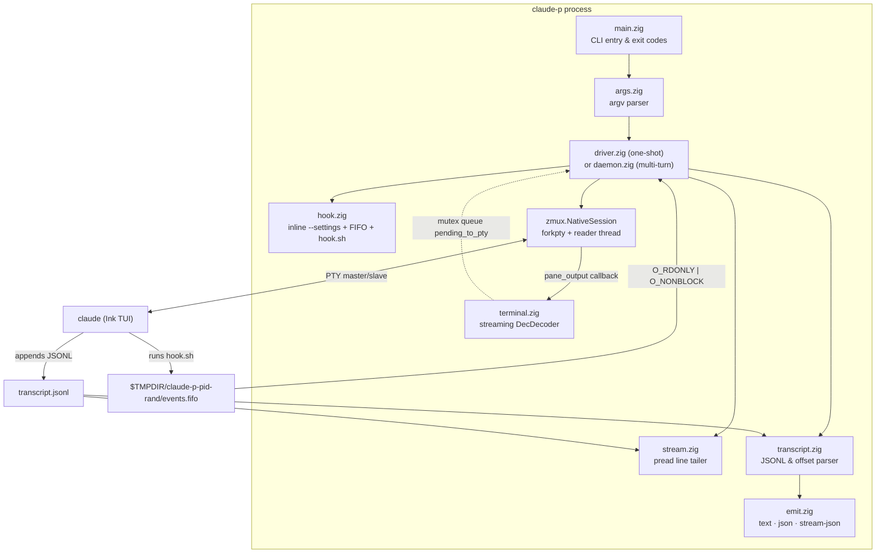

# `claude-p` — Technical Specification

`claude-p` is a Zig 0.15.2 library and CLI (`0.1.3`) that emulates `claude -p`
(Claude Code print mode) by driving the interactive `claude` binary inside an
in-process [zmux][zmux] PTY session.

One-shot `text` and `json` stdout follow `claude -p`'s result shape.
`stream-json` emits filtered Claude Code session-transcript JSONL lines plus a
`claude -p`-shaped final `result` envelope; it is not wire-compatible with
`claude -p --output-format stream-json` (§7.1). Daemon mode
(`claude-p daemon`) drives a single interactive session across multiple turns
over NDJSON on stdin and stdout.

[zmux]: https://github.com/smithersai/zmux

---

## 1. Premise

When `claude -p` is unavailable, running `claude` non-interactively requires
emulating an interactive terminal:

1. **A real PTY.** Ink (Claude Code's terminal renderer) exits if stdin is not
   a TTY. `zmux.NativeSession` provides `openpty(3)`/`forkpty(3)`, a reader
   thread, bounded scrollback, `writeInput()`/`send()`, and an `EventSink`.
2. **Terminal query replies.** At boot, Ink emits DEC/XTerm queries and blocks
   until the terminal replies. `terminal.DecDecoder` scans incoming PTY bytes
   and synthesizes the five required responses.
3. **Structured completion.** Scraping the rendered TUI breaks across UI
   releases. Inline `--settings` hooks (`SessionStart`, `UserPromptSubmit`,
   `Stop`, `StopFailure`) relayed through a per-run FIFO provide exact lifecycle events and
   the session transcript path without touching `~/.claude/`.

---

## 2. Architecture



### 2.1 Module inventory (`src/`)

| File | Responsibility |
| --- | --- |
| `main.zig` | CLI entry point; routes one-shot vs `daemon`; maps errors to exit codes. |
| `args.zig` | Argparse for the `claude -p` flag surface, variadic flags, boolean passthrough table, and cross-flag checks. |
| `terminal.zig` | Streaming `DecDecoder` answering DA1, DA2, DSR, XTVERSION, and `18t`; carries split sequences across reads. |
| `hook.zig` | Per-run temp dir, `mkfifo(0o600)`, `hook.sh` relay script, inline `--settings` builder (with `extra_hooks` and `extra_settings_json`), and payload extractors. |
| `driver.zig` | One-shot lifecycle: env filtering, startup dialog state machine, paced bracketed paste, prompt-acceptance watchdog, live tailing, transcript race retry, teardown. |
| `daemon.zig` | Multi-turn NDJSON daemon (`user`, `ping`, `interrupt` → `system/init`, live transcript, per-turn `result`, error frames, `pong`), PTY idle and transcript watchdogs, and `[pty-trace]`. |
| `transcript.zig` | Session JSONL parser (`parse`, `parseFile`, `parseFileFromOffset`); extracts final assistant text, session ID, error flag and subtype, and token usage deduplicated by `message.id`; drops repeated records by `uuid`. |
| `stream.zig` | Non-blocking `pread`-based JSONL line tailer (`Tailer`) that holds partial fragments until `\n`; a partial line over 16 MiB (`default_max_partial_bytes`) is discarded through its newline. |
| `emit.zig` | Output formatters for `text`, `json`, and `stream-json`. |
| `root.zig` | Public Zig library facade and semantic version (`0.1.3`). |

### 2.2 zmux integration and threading

`zmux` is fetched via `build.zig.zon` and pinned by commit SHA and package hash
(Zig **0.15.2**). `claude-p` uses only `zmux.NativeSession` (no `zmuxd`).

Concurrency rule: zmux's reader thread invokes `driver.onZmuxEvent` on every
`pane_output` chunk. The callback MUST NOT call back into `session.writeInput`
directly (re-entering zmux locks). Instead it:

1. Feeds the chunk to the per-session `terminal.DecDecoder` (`shared.dec`) and
   appends reply bytes to `shared.pending_to_pty` under `shared.write_mutex`.
2. Appends raw bytes to the 8192-byte rolling ring `shared.recent` and updates
   `shared.bytes_seen` and `shared.last_output_ns` under `shared.recent_mutex`.

The main loop drains `pending_to_pty` via `flushPendingToPty` into
`session.writeInput` on every iteration and inside every quiescence sleep.

---

## 3. Terminal handshake (`src/terminal.zig`)

`DecDecoder.feed` scans CSI sequences in each incoming PTY chunk. It carries
an incomplete trailing `ESC` or CSI (up to 32 bytes) into the next call, so a
query split across two reads is still answered. One decoder per PTY; not
thread-safe. `respondToDecQueries` / `respondToDecQueriesSized` are one-shot
forms that drop an incomplete trailing sequence and must not be used on a live
stream.

| Query | Byte sequence | Reply emitted | Meaning |
| --- | --- | --- | --- |
| DA1 | `ESC [ c` or `ESC [ 0 c` | `ESC [ ? 1 ; 2 c` | VT100 with AVO |
| DA2 | `ESC [ > c` or `ESC [ > 0 c` | `ESC [ > 0 ; 0 ; 0 c` | Secondary device attributes |
| DSR (CPR) | `ESC [ 6 n` | `ESC [ 1 ; 1 R` | Cursor at row 1, col 1 |
| XTVERSION | `ESC [ > q` or `ESC [ > 0 q` | `ESC P > \| claude-p ESC \` | Terminal identity DCS string |
| Window size | `ESC [ 18 t` | `ESC [ 8 ; <rows> ; <cols> t` | The decoder's configured `rows` × `cols` (default 40 × 120) |

---

## 4. Hook relay and inline settings (`src/hook.zig`)

`hook.createWithOptions` validates inputs before touching disk, creates
`$TMPDIR/claude-p-<pid>-<rand>/` exclusively with mode `0o700` (64 random
bits from the OS CSPRNG in the name), creates `events.fifo` (`0o600`), writes
an executable `hook.sh` (`0o700`), and builds the inline `--settings` JSON.

### 4.1 Relay hooks

Five hooks are always registered first (index 0) with matcher `"*"`. `hook.sh`
embeds the FIFO path and a per-run nonce (16 lowercase hex characters) as
single-quoted shell words and appends one line per event:

```text
<nonce>\t<event>\t<json>\n
```

| Event | Used for |
| --- | --- |
| `SessionStart` | Ready signal; extracts `transcript_path` and `session_id`. |
| `UserPromptSubmit` | Confirms delivery; extracts `prompt` for truncation check. |
| `Stop` | Turn complete; extracts `transcript_path`, `last_assistant_message`, `session_id`. |
| `StopFailure` | Turn ended in an API error. One-shot returns an `is_error: true` summary with the hook's error text (exit `1`); the daemon emits a `stop_failure` error frame and returns to `idle`. |
| `PermissionRequest` | Claude Code is about to show a permission prompt that no one can answer. One-shot returns `RunError.PermissionPromptBlocked` (exit `2`) at once instead of waiting for the `Stop` timeout. The daemon writes ESC, emits a turn-ending `type:"result"` frame with `subtype: "error_during_execution"` and `error: "permission_prompt_blocked"` (the tool name in `message`), and returns to `.idle`. |

`hook.parseLineWithNonce` returns a line only when its nonce equals
`HookHarness.nonce`; other lines are dropped. `hook.sh` reads no
environment variable to find the FIFO, and `CLAUDE_P_FIFO` is not exported to
the child (§5.1).

`events.fifo` is opened `O_RDONLY | O_NONBLOCK` **before** spawning `claude`
so a hook script appending to the FIFO never blocks waiting for a reader. If
`script_path` contains characters outside `[A-Za-z0-9/._-]`, the command
string is single-quoted for `/bin/sh`.

### 4.2 Settings composition

`hook.CreateOptions` (exposed via `driver.Options` and the `--extra-hook` /
`--setting-json` CLI flags):

- `extra_hooks: []const ExtraHook`: appended after relay hooks for matching
  events or grouped under custom event names. Empty event or command returns
  `error.InvalidExtraSettings`.
- `extra_settings_json: ?[]const u8`: parsed with `parse_numbers = false`
  (preserving exact numeric literals). Top-level keys other than `"hooks"` are
  merged into the generated settings object. Non-object or malformed JSON,
  nesting deeper than `max_extra_settings_depth` (128, counting the top-level
  object as 1), or `"disableAllHooks": true` (which would silence the relay
  hooks) returns `error.InvalidExtraSettings`. `"disableAllHooks": false`
  passes through.

---

## 5. One-shot driver (`src/driver.zig`)

### 5.1 Child environment filtering (`buildChildEnv`)

`shouldStripChildEnv` strips only nested-session / parent-agent markers:

- Exact names: `CLAUDECODE`, `AI_AGENT`, `CLAUDE_CODE_ENTRYPOINT`,
  `CLAUDE_CODE_SSE_PORT`, `CLAUDE_CODE_CHILD_SESSION`,
  `CLAUDE_CODE_SESSION_ID`.
- Prefixes: `CLAUDE_CODE_SESSION_`, `CLAUDE_CODE_PARENT_`,
  `CLAUDE_CODE_SUBAGENT_`.

All other `CLAUDE_CODE_*` and auth/provider variables are **preserved intact**
(`CLAUDE_CODE_OAUTH_TOKEN`, `CLAUDE_CODE_USE_BEDROCK`,
`CLAUDE_CODE_USE_VERTEX`, `CLAUDE_CODE_USE_FOUNDRY`, `CLAUDE_CONFIG_DIR`,
`CLAUDE_CODE_FORCE_SESSION_PERSISTENCE`).

`buildChildEnv` drops any inherited `CLAUDE_P_FIFO` (it never exports one),
sets `TERM=xterm-256color`, and defaults
`CLAUDE_CODE_FORCE_SESSION_PERSISTENCE=1` if unset.

### 5.2 Startup dialog state machine (`maybeHandleStartupDialogs`)

Before `SessionStart`, the driver monitors the CSI-stripped 8192-byte recent
buffer once PTY output has been quiet for `80 ms` (`dialog_quiescence_ms`).
CSI/OSC/DCS stripping uses stack buffers (zero heap allocation).

Three modals are recognized (`classifyDialog`, latest marker wins; suppressed
if the main prompt footer `"for shortcuts"` painted after the modal):

| Dialog | Detection keywords | Affirmative markers | Negative markers |
| --- | --- | --- | --- |
| `.trust` | `trust` + `folder` | `Yes,Itrust`, `Yes,proceed` | `No,exit` |
| `.bypass_permissions` | `bypass` + `permissions` + `accept` | `Yes,Iaccept` | `No,exit` |
| `.dev_channels` | `loading` + `development` + `channels` | `Iamusing` | `Exit` |

`analyzeDialog` locates the last `❯` cursor glyph (`\xe2\x9d\xaf`) and checks
whether it points at an affirmative or negative option, whether options are
numbered (`<digit>. <affirmative>`), and whether the affirmative option lies
below the cursor.

**Intent gate (`dialogConfirmAllowed`).** `.trust` is always answered.
`.bypass_permissions` is answered only when this invocation asked for bypass:
`skip_permissions`, `permission_mode == "bypassPermissions"`, or
`--dangerously-skip-permissions` / `--permission-mode bypassPermissions` in
`extra_args`. `.dev_channels` is answered only when `extra_args` contains
`--dangerously-load-development-channels`. Otherwise no key is sent,
`DialogState.refused` is set, and `run` returns
`RunError.UnexpectedStartupDialog` (exit `2`); the daemon writes an
`unexpected_startup_dialog` error frame and exits `2`. A dialog raised by
settings files alone is never approved.

Rules enforced by `chooseDialogAction` / `decideDialog`:
- **Never send Enter (`\r`) unless `❯` is verified on the affirmative option.**
  (Claude Code 2.1 preselects `"No, exit"` above `"Yes, I trust"` without
  option numbers.)
- If on negative: send `<digit>` on numbered menus (falling back to arrow keys
  if a digit did not move the cursor), otherwise send Down (`\x1b[B`) if
  affirmative is below or Up (`\x1b[A`) if above.
- Wait for repaint; retry dropped keys after `1500 ms` (`dialog_retry_ms`) if
  zero fresh bytes arrived. Hard cap: `16` keys (`max_dialog_keys`).

### 5.3 Quiescence, paced bracketed paste, and delivery watchdog

1. **Settle before typing (`settleBeforePrompt`):**
   - Fresh run: wait for `80 ms` PTY silence (max `2000 ms`), sleep `100 ms`
     pumping DEC replies, wait again for `80 ms` silence (max `1000 ms`).
   - Resume run (`--resume`, `-r`, `--continue`, `-c`): wait for `400 ms`
     silence (max `6000 ms`) while Ink repaints the restored transcript.
2. **Snapshot offset:** record `pre_prompt_transcript_offset = stat(transcript_path).size`.
3. **Paced bracketed paste (`typePrompt` / `PasteChunker`):**
   - Write `\x1b[200~`.
   - Split prompt into chunks of at most `512` bytes (half of macOS's 1024-byte
     `TTYHOG`), never splitting a multi-byte UTF-8 sequence, neutralizing any
     embedded `\x1b[201~` by dropping its trailing `~`.
   - Sleep `8 ms` between chunks.
   - Write `\x1b[201~`, sleep `120 ms` (`ink_enter_debounce_ms`), write `\r`.
4. **Acceptance & truncation watchdog:**
   - Prompt is accepted when `UserPromptSubmit` arrives or transcript file size
     exceeds `pre_prompt_transcript_offset`.
   - On `UserPromptSubmit`, if the prompt has more than `64` non-whitespace
     bytes and Claude's received text is not a paste placeholder
     (`[Pasted text #` or `<pasted_content`), having fewer non-whitespace bytes
     than sent returns `RunError.PromptTruncated`.
   - If unacknowledged after `4000 ms` (`prompt_accept_timeout_ms`), send
     Ctrl-U (`\x15`), wait for quiescence, and reinject. After `4` total
     injections (`max_prompt_injections`), return `RunError.PromptNotAccepted`.
   - On `PermissionRequest` while awaiting `Stop`, return
     `RunError.PermissionPromptBlocked` (exit `2`).
   - **Transcript watchdog (`transcript_idle_timeout_ms`, CLI
     `--transcript-idle-timeout`, default `600 s`, `0` disables):** while
     awaiting `Stop`, return `RunError.TranscriptStalled` (exit `124`) when
     neither the transcript nor the PTY has grown for the threshold.
   - If the child exits early while awaiting `Stop`, wait `250 ms`
     (`post_exit_fifo_grace_ms`) for any in-flight FIFO payload before returning
     `TranscriptUnavailable` (if accepted) or `PromptNotAccepted` (if not).

### 5.4 Transcript race, resume isolation, and teardown

On `StopFailure` while awaiting `Stop`: parse the turn's transcript slice
once first, so `usage`, `num_turns`, and `session_id` survive, then force
`is_error = true`, replace `result` with the hook's error text when it has
one, and clear a transcript `"success"` subtype so the emitted `subtype` is
`"error_during_execution"`. Only when no transcript slice parses does it fall
back to `synthesizeStopFailureSummary` (`is_error = true`, the hook's error
text or a default message, `session_id`, zero usage). The daemon does the
same and adds `"error":"stop_failure"` to the turn's `result` frame.

On `Stop` (provisional): the driver confirms immediately if Claude writes a
`system`/`stop_hook_summary` record with `preventedContinuation: false`,
supersedes immediately on `preventedContinuation: true` or continuation
records, and otherwise waits a fallback confirmation window (`150 ms` by
default, `2000 ms` when `--extra-hook Stop=...` is registered;
`driver.stopConfirmationNs`) before ending the turn, so a blocking `Stop` hook can make Claude continue. A
later `Stop` replaces the payload (Claude Code sends `stop_hook_active: true`
on the continued turn) and restarts the window; new assistant activity in the
transcript after the provisional `Stop` discards it. The daemon applies the
same window and the same `stop_hook_summary` confirmation.

Once `Stop` is confirmed, one bounded pump-and-parse loop runs up to
`20 × 20 ms` (and never past the run deadline). Each attempt pumps new
transcript lines to the `stream-json` writer, then parses
`[pre_prompt_transcript_offset..EOF]` via
`transcript.parseFileFromOffsetWithOptions`. It exits early as soon as the
parsed final text matches Stop's `last_assistant_message` (or is an error),
and after the last attempt replaces mismatched text with Stop's
`last_assistant_message` (`preferStopText`). A `StopFailure` turn parses
once and does not retry.
1. If the transcript still yields no assistant message, synthesize a `Summary`
   from Stop's `last_assistant_message` and `session_id`; otherwise return
   `RunError.TranscriptUnavailable`.
2. Call `session.terminate()` (zmux sends `SIGTERM`, waits ~200 ms, escalates
   to `SIGKILL`).

### 5.5 Cancellation

`driver.requestInterrupt()` (async-signal-safe) makes every in-flight `run`
return `RunError.Interrupted` after its `defer`s remove the PTY and temp dir.
`driver.clearInterrupt()` resets the flag for a library caller that wants to
run again. `main.zig` installs handlers for `SIGINT`, `SIGTERM`, and `SIGHUP`
that call it (or `daemon.requestInterrupt()`), then exits `128 + sig`. A
duplicate signal within `2 s` of the first is ignored, so a process-group
`SIGINT` that reaches the binary both from the kernel and through
`bin/claude-p.js` still cleans up. A later signal restores the default
disposition and re-raises. `RunError.Interrupted` without a caught signal
(a library caller's `requestInterrupt`) exits `2`.

---

## 6. Daemon mode (`src/daemon.zig`)

`claude-p daemon [OPTIONS]` maintains one interactive `claude` session across
turns. Its state machine has three states: `waiting_for_ready`, `idle`, and
`busy`.

### 6.1 Wire protocol (NDJSON)

**Stdin (client → daemon).** One JSON value per `\n`-terminated line, at most
16 MiB; a final unterminated line is processed at EOF. Blank and
whitespace-only lines are ignored silently. `user` frames that arrive before
`SessionStart` or while `.busy` wait in `prompt_queue`, capped at `64` prompts
and `64 MiB` of text.

| Line | Effect |
| --- | --- |
| `{"type":"user","message":{"role":"user","content":"…"}}` | Queued into `prompt_queue`. Also accepts an array of `{"type":"text","text":"…"}` blocks or top-level `{"type":"user","content":"…"}`. No non-empty text → `invalid_user_message`; a non-text content block → `unsupported_content_block`. A full queue → `queue_full`. |
| `{"type":"ping"}` | Answered with `pong` by the main loop in any state. |
| `{"type":"interrupt"}` | While `.busy` and not already interrupting: write ESC (`\x1b`) and open a `1500 ms` window (`interrupt_window_ms`). A `Stop` inside the window ends the turn with a normal `result`. Otherwise emit `{"type":"result","subtype":"interrupted","error":"interrupted","is_error":false,…}`, set `after_interrupt`, and return to `.idle` with the session open. The next prompt is preceded by Ctrl-U, and a late `Stop` is ignored until the new turn shows life (`stopBelongsToTurn`). Ignored when not `.busy`. |
| Blank or whitespace-only | Ignored; no frame. |
| Valid JSON with unknown or missing `type`, or a non-object | `unsupported_frame_type` protocol error. |
| Not valid JSON | `invalid_json` protocol error. |
| Over 16 MiB | `stdin_line_too_large` protocol error; the rest of that line is discarded. |

**Stdout (daemon → client):**
- `{"type":"system","subtype":"init","session_id":"…"}` — emitted once on
  `SessionStart`.
- Raw transcript JSONL lines — tailed live via `stream.Tailer` (transcript
  `type:"result"` lines excluded). On `--resume` or `--continue`, the tailer
  seeks to existing EOF on open so historical turns are not re-emitted.
- Per-turn `result` envelope (same schema as `emit.emitJson`) — emitted on
  confirmed `Stop` after a pump-and-parse loop of up to `30 × 25 ms` that
  exits early when the parsed text matches Stop's `last_assistant_message`,
  computed from the transcript byte range `[turn_start_pos..turn_end_pos)`
  (falling back to Stop's `last_assistant_message`). A `StopFailure` turn
  keeps the parsed usage, sets `is_error: true`, and carries
  `"error":"stop_failure"`.
- `{"type":"pong","ts":<unix_ms>}` — emitted in reply to `ping`.
- Protocol errors (`emit.writeProtocolError`) —
  `{"type":"error","error":"<reason>"}`. They reject one input or FIFO line,
  affect no turn, and the daemon continues. `type:"result"` is reserved for
  frames that end a turn or the session.
- Turn and session error frames (`emit.emitErrorResult`) — the `result`
  envelope with `subtype: "error"`, `"error_during_execution"`, or
  `"interrupted"`, an extra `error` reason, `result: ""`, and zeroed
  counters. Clients tell them from turn results by the `error` field:

| `error` | Frame | Kind | Daemon continues? |
| --- | --- | --- | --- |
| `invalid_json`, `unsupported_frame_type`, `invalid_user_message`, `unsupported_content_block`, `stdin_line_too_large`, `fifo_line_too_large`, `queue_full` | `type:"error"` | Protocol error, no turn affected | Yes |
| `prompt_not_accepted`, `stop_failure`, `result_unavailable`, `interrupted`, `permission_prompt_blocked` | `type:"result"` | Turn ended without a normal result | Yes, returns to `.idle` |
| `claude_not_found`, `spawn_failed` | `type:"result"`, `subtype:"error"`, plus `stage` | Startup failure before `system/init` | No, exit `2` |
| `unexpected_startup_dialog`, `prompt_truncated`, `child_exited` | `type:"result"` | Session failure | No, exit `2` |
| `session_start_timeout`, `idle_timeout`, `transcript_stalled` | `type:"result"` | Watchdog | No, exit `124` |

### 6.2 Watchdogs, telemetry, and current implementation notes

- **Startup timeout (`--timeout`, default `300 s`, `0` disables):** writes a
  `session_start_timeout` error frame and exits `124` if `SessionStart` does
  not arrive before the deadline.
- **Idle-progress watchdog (`--idle-timeout`, default `180 s`, `0` disables):**
  while `.busy`, writes `idle_timeout` and exits `124` if no PTY bytes arrived
  for longer than the threshold. Resets `last_output_ns` on `idle → busy` and
  never trips while `.idle` or `.waiting_for_ready`.
- **Transcript watchdog (`--transcript-idle-timeout`, default `600 s`, `0`
  disables):** while `.busy`, writes `transcript_stalled` and exits `124` if
  the transcript stops growing for longer than the threshold. Spinner output
  does not reset it.
- **PTY byte-rate trace:** writes
  `[pty-trace] state=… pty_bytes=… pty_delta=… last_byte_age_ms=… turn_age_ms=… transcript_pos=…`
  to stderr. **Off by default.** `--debug` enables it every `60 s`.
  `CLAUDE_P_PTY_TRACE=<seconds>` sets the interval with or without `--debug`;
  `0`/`off`/`false`/`no` disables it.
- **Shutdown:** on stdin EOF, finishes any active turn and queued prompts,
  calls `session.terminate()`, drains remaining transcript bytes, and returns
  exit code `0`. EOF before `SessionStart` with nothing queued also exits `0`.
- **Options:** `daemon.run` returns `error.InvalidOptions` for the options
  `driver.validateOptions` rejects (see §8).
- **Shared with the one-shot driver:** `daemon.zig` calls
  `driver.maybeHandleStartupDialogs` for pre-SessionStart dialogs,
  `driver.PasteChunker` and the same paste constants (`512` B chunks, `8 ms`
  gaps, `120 ms` Enter debounce) for every prompt, and
  `driver.buildChildEnv` for the filtered child environment. The daemon does
  not call the blocking `driver.typePrompt`: `PendingPaste` writes one chunk
  per event-loop tick, so `ping`, `interrupt`, FIFO events, and DEC replies
  stay responsive during a large paste. `interrupt` or `PermissionRequest`
  cancels a paste in flight (closing `\x1b[201~` when a chunk was sent, then
  `Ctrl-U`).

---

## 7. Output formats and exit codes

### 7.1 Output formats (`src/emit.zig`)

| `--output-format` | Stdout |
| --- | --- |
| `text` (default) | Final assistant text + `\n` (avoids double trailing newline). |
| `json` | Single JSON line: `{type:"result", subtype, session_id, result, is_error, duration_ms, duration_api_ms, num_turns, total_cost_usd, usage:{input_tokens, output_tokens, cache_read_input_tokens, cache_creation_input_tokens}, permission_denials:[]}`. |
| `stream-json` | Every JSON-object line appended to the session transcript during the run, except transcript `type:"result"` lines, streamed as flushed, then the `result` object above. Requires `--verbose` in one-shot mode. |

`subtype` is `"success"` when `is_error` is false. When true it is the
transcript `result` line's own subtype if present, else
`"error_during_execution"`. An assistant entry with `isApiErrorMessage: true`
or model `<synthetic>` sets `is_error`.

**`stream-json` contract.** Event lines are Claude Code transcript records,
not `claude -p` stream-json events. They use the transcript schema (for
example `sessionId`, not `session_id`), one-shot mode emits no
`system`/`init` line, and line types follow the transcript. Only the final
`result` line has the `claude -p` shape. Consumers should read `session_id`
from that line.

`transcript.zig` accepts both `sessionId` (real Claude Code transcripts) and
`session_id` (legacy stream-json). Usage and `num_turns` count each
`message.id` once, keeping the last usage seen for that id (Claude Code can
write several lines per message); entries without an id each count. A record
whose `uuid` was already seen is skipped entirely, so a rewritten transcript
record never duplicates assistant text.

### 7.2 Exit codes (`src/main.zig`)

The native binary sets every code; `bin/claude-p.js` passes it through.

| Code | Source | Meaning |
| --- | --- | --- |
| `0` | `Result.exitCode()` / `daemon.run` | `is_error == false`, or clean daemon EOF/exit. |
| `1` | `Result.exitCode()` | Assistant returned `is_error == true` (including `StopFailure`). |
| `2` | `main.zig` / `daemon.run` / `bin/claude-p.js` | Bad or rejected arguments, empty prompt, `PROMPT` with `--input-file`, missing binary, or any other run error (`PermissionPromptBlocked`, `InvalidOptions`, `PromptNotAccepted`, `PromptTruncated`, `TranscriptUnavailable`, `SpawnFailed`, `InvalidExtraSettings`, `InvalidCwd`, `UnexpectedStartupDialog`, `Interrupted` without a signal); daemon `claude_not_found`, `spawn_failed`, `child_exited`, `unexpected_startup_dialog`, `prompt_truncated`. |
| `124` | `main.zig` (`exitCodeForRunError`) / `daemon.run` | `SessionStartTimeout`, `StopTimeout`, `IdleTimeout`, `TranscriptStalled`; daemon `session_start_timeout`, `idle_timeout`, `transcript_stalled`. |
| `128 + sig` | `main.zig` (`exitIfSignaled`) | `SIGINT`, `SIGTERM`, or `SIGHUP` received; exits after cleanup (e.g. `130` for `SIGINT`). Takes precedence over the `Interrupted` error. |

**Failure diagnostics.** By default a run failure writes only the stage,
cause, status, elapsed time, and PTY byte count to stderr (for example
`claude-p: timed out after 300000 ms waiting for claude to finish the turn
(PTY bytes=N)`, then `claude-p: StopTimeout: <hint>`). It never prints screen
contents by default, because the PTY can show prompt or tool text. The
recent-screen excerpt (`claude-p: recent claude output:`) appears only with
`--debug` or `CLAUDE_P_DEBUG_SCREEN=1`.

---

## 8. CLI surface (`src/args.zig`)

```text
claude-p [OPTIONS] [PROMPT]
claude-p daemon [OPTIONS]
```

Explicitly parsed flags: `--output-format`, `--model`,
`--allowedTools` / `--allowed-tools` (repeatable, variadic),
`--disallowedTools` / `--disallowed-tools` (repeatable, variadic), `-n` /
`--name` (one value), `--permission-mode`, `--dangerously-skip-permissions`,
`--system-prompt`, `--append-system-prompt`, `--add-dir` (repeatable,
variadic), `--mcp-config` (repeatable, variadic), `--setting-sources`,
`--resume` / `-r`, `--continue` / `-c`, `--session-id`, `--cwd`,
`--input-file`, `--verbose`, `--timeout`, `--idle-timeout` (daemon),
`--transcript-idle-timeout` (one-shot and daemon), `--extra-hook` (repeatable), `--setting-json`,
`--debug`, `--`, `-h`/`--help`, `-v`/`--version`.

- **Value syntax:** every single-value flag accepts `<flag> <value>` (next
  token consumed unconditionally) and `<flag>=<value>`.
  `--allowedTools`, `--disallowedTools`, `--add-dir`, and `--mcp-config`
  without `=` consume following non-dash tokens; the `=` form takes exactly
  one. Repeats accumulate, and every tool rule is forwarded in order as its
  own `--allowedTools <rule>` / `--disallowedTools <rule>` pair. Put `PROMPT`
  first or after `--` so a variadic flag does not consume it. `-n`/`--name`
  takes one value and is forwarded to `claude`.
- **Prompt composition (`main.zig`):** `PROMPT` with piped stdin sends
  `<stdin>\n\n<PROMPT>` (trailing `\r\n` trimmed from stdin; empty stdin
  leaves `PROMPT` alone). If stdin produces no data or EOF within `3 s`
  (`stdin_grace_ms`), `claude-p` warns and sends `PROMPT` alone. `PROMPT` with
  `--input-file`, or no prompt with stdin on a TTY, exits `2`.
- **Rejected (`ParseError.UnsupportedFlag`, `isRejectedFlag`):** `-p`,
  `--print`, `--settings`, `--bare`, `--safe-mode`,
  `--no-session-persistence`, `--input-format`, `--json-schema`,
  `--max-budget-usd`, `--max-turns`, `--fallback-model`,
  `--include-partial-messages`, `--forward-subagent-text`,
  `--replay-user-messages`, `--verbose-thinking`, each also in its
  `<flag>=<value>` form. Claude Code skips `--settings` hooks under `--bare`
  and `--safe-mode`; `--no-session-persistence` stops the transcript
  `claude-p` reads; the rest are print-mode-only, and `claude-p` neither
  enforces a turn cap or model fallback nor emits partial, subagent,
  replayed, or thinking events. Library callers get `RunError.InvalidOptions`
  from `driver.validateOptions` (and `daemon.run`) when `max_turns`,
  `fallback_model`, or a rejected flag in `extra_args` is set.
- **Daemon output format:** daemon mode always writes stream-json, so an
  explicit `--output-format text` or `json` is `ParseError.UnsupportedFlag`.
- **Cross-flag rule (`ParseError.StreamJsonRequiresVerbose`):** one-shot
  `--output-format stream-json` without `--verbose`.
- **Passthrough:** unknown flags are forwarded verbatim. The known boolean
  long flags in `known_boolean_long_flags` (`--allow-dangerously-skip-permissions`,
  `--ax-screen-reader`, `--background`, `--bg`, `--brief`, `--chrome`,
  `--no-chrome`, `--dangerously-skip-permissions`, `--desktop`,
  `--disable-slash-commands`, `--exclude-dynamic-system-prompt-sections`,
  `--fork-session`, `--ide`, `--include-hook-events`, `--mcp-debug`,
  `--restricted`,
  `--strict-mcp-config`, `--tmux`) do not consume the following argument. The
  table also lists `--bare` and `--safe-mode`, which `parse` rejects first.

---

## 9. Public Zig library API (`src/root.zig`)

```zig
pub const version: std.SemanticVersion = .{ .major = 0, .minor = 1, .patch = 3 };

pub const OutputFormat = args.OutputFormat; // enum { text, json, stream_json }
pub const Options = driver.Options;
pub const Result = driver.Result;
pub const Usage = transcript.Usage;

pub fn run(allocator: std.mem.Allocator, opts: Options) RunError!Result;
```

Submodules re-exported: `args`, `transcript`, `emit`, `hook`, `terminal`,
`driver`, `stream`, `daemon`.

---

## 10. Build, distribution, and tests

- **Zig version:** `0.15.2` (enforced by `zmux`).
- **System libraries:** `libc` everywhere; `util` on Linux, `proc` on macOS.
- **CI cross-compile targets (`.github/workflows/ci.yml`):** `aarch64-macos`,
  `x86_64-macos`, `x86_64-linux-musl`, `aarch64-linux-musl`.
- **npm distribution:** `bin/claude-p.js` spawns
  `prebuilt/<platform>-<arch>/claude-p` and forwards `SIGINT`, `SIGTERM`,
  `SIGHUP`. `scripts/install.js` downloads `claude-p-<platform>-<arch>.gz`
  from GitHub Releases and verifies its SHA-256 before writing.
  - **Trust root:** the `checksums.json` bundled in the npm tarball
    (`{ version, assets: { "<asset>.gz": sha256 }, binSha256: { "<plat>-<arch>": sha256 } }`),
    written by `scripts/publish.mjs`. When present it is the only source of
    truth; a version mismatch, missing entry, or digest mismatch is a
    `ChecksumError`, raised before any reuse check or download when either
    `assets[<asset>]` or `binSha256[<plat>-<arch>]` is missing. Without it (source checkout), the release's `SHA256SUMS`
    is required for versions `>= 0.1.3` and HTTP 404 is a `ChecksumError`.
  - **Reuse:** an existing destination is reused only when `checksums.json`
    has a `binSha256` for the platform and the file matches it exactly. The
    file must be a regular file (`fstat` on the opened descriptor), executable
    (`X_OK`), and at most 64 MiB before it is hashed. Otherwise, when
    `checksums.json` exists, the installer unlinks the rejected file before
    downloading, so an offline exit `0` never leaves it in place; it then
    downloads, verifies the compressed and decompressed digests, and
    atomically renames the new binary into place.
  - **Download:** `https` only, to `github.com` and `*.githubusercontent.com`,
    at most 5 redirects, one overall monotonic 30 s deadline across DNS,
    connect, redirects, and body, plus a socket inactivity timeout; 32 MiB
    compressed / 64 MiB decompressed caps.
  - **Staging:** the package root, `prebuilt/`, and `prebuilt/<plat>-<arch>/`
    are rejected if they are symlinks. The binary is written through an
    exclusively created (`O_CREAT | O_EXCL`), randomly named staging file,
    `fchmod`ed to `0755` through its descriptor, and renamed into place. Only a
    staging file the installer created is unlinked on failure. A symlink at the
    destination is refused.
  - **Exit codes:** `ChecksumError`, `UnsafePathError`, local filesystem
    errors (`ENOSPC`, `EACCES`, `EPERM`, `EISDIR`, `EROFS`), oversize or
    off-host downloads, and any unclassified error exit `1`. Only
    connectivity failures (`NetworkError` from `get()`: HTTP status,
    timeout, deadline, redirect; or socket codes `ENOTFOUND`, `EAI_AGAIN`,
    `ECONNREFUSED`, `ECONNRESET`, `ETIMEDOUT`, unreachable host/network)
    warn (naming `CLAUDE_P_SKIP_DOWNLOAD=1`, `CLAUDE_P_STRICT_INSTALL=1`, and
    `NODE_USE_ENV_PROXY=1` for proxies on Node `>= 22.21`/`24`) and exit `0`,
    or exit `1` when `CLAUDE_P_STRICT_INSTALL=1`. `CLAUDE_P_SKIP_DOWNLOAD=1`
    skips the download.
  - **Raw publish guard:** `package.json` `prepublishOnly` refuses
    `npm publish` from a tree without `checksums.json`; publish through
    `npm run release`.
- **Releases (`.github/workflows/release.yml`):** a `build` job (read-only, no
  secrets) checks the tagged commit is an ancestor of `origin/main` and the tag
  is exactly `v<version>`, builds all 4 targets, and writes `SHA256SUMS` and
  `checksums.json`; `verify-macos` asserts an `arm64` `macos-15` runner,
  checks the `darwin-arm64` digest, and requires `--version` to print exactly
  the tag version; `publish` (environment `release`) creates the GitHub release
  and publishes to npm with `--provenance`. `publish.mjs` refuses to build or
  attach assets unless the local tag's peeled commit equals `HEAD` and the
  remote tag, if present, peels to the same commit. Published release assets
  are never overwritten: on reruns `publish.mjs` verifies every existing asset
  by digest against `SHA256SUMS` / `checksums.json` and uploads only missing
  ones. The npm package is staged in a private temporary directory with the
  generated `checksums.json`; the packed tarball must contain `checksums.json`
  covering all 4 platforms at the `package.json` version before `npm publish`
  runs there. The repository-root `checksums.json` is never written.
- **Version lockstep:** `package.json`, `build.zig.zon`, and `src/root.zig`
  must agree (verified in CI by `node scripts/publish.mjs --check-versions`).
- **Unit tests:** `zig build test --summary all` runs every module test in
  `src/` (zero external dependencies) and prints the current count.
- **Integration tests:** `CLAUDE_P_E2E=1 zig build test-integration --summary all`
  runs `tests/integration.zig` against the real `claude` binary. No mocks.
- **JS supply-chain tests:** `node --test .smithers/tests/install-checksum.test.mjs tests/prop/js_supplychain_prop.mjs`.
