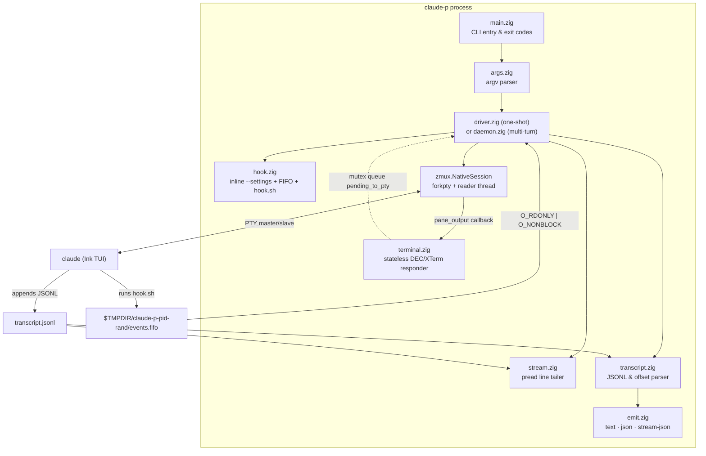

# `claude-p` — Technical Specification

`claude-p` is a Zig 0.15.2 library and CLI (`0.1.3`) that emulates `claude -p`
(Claude Code print mode) by driving the interactive `claude` binary inside an
in-process [zmux][zmux] PTY session.

One-shot stdout matches `claude -p`'s `text`, `json`, and `stream-json`
formats. Daemon mode (`claude-p daemon`) drives a single interactive session
across multiple turns over NDJSON on stdin and stdout.

[zmux]: https://github.com/smithersai/zmux

---

## 1. Premise

When `claude -p` is unavailable, running `claude` non-interactively requires
emulating an interactive terminal:

1. **A real PTY.** Ink (Claude Code's terminal renderer) exits if stdin is not
   a TTY. `zmux.NativeSession` provides `openpty(3)`/`forkpty(3)`, a reader
   thread, bounded scrollback, `writeInput()`/`send()`, and an `EventSink`.
2. **Terminal query replies.** At boot, Ink emits DEC/XTerm queries and blocks
   until the terminal replies. `src/terminal.zig` scans incoming PTY bytes and
   synthesizes the five required responses.
3. **Structured completion.** Scraping the rendered TUI breaks across UI
   releases. Inline `--settings` hooks (`SessionStart`, `UserPromptSubmit`,
   `Stop`) relayed through a per-run FIFO provide exact lifecycle events and
   the session transcript path without touching `~/.claude/`.

---

## 2. Architecture



### 2.1 Module inventory (`src/`)

| File | Responsibility |
| --- | --- |
| `main.zig` | CLI entry point; routes one-shot vs `daemon`; maps errors to exit codes. |
| `args.zig` | Argparse for the `claude -p` flag surface, variadic flags, boolean passthrough table, and cross-flag checks. |
| `terminal.zig` | Stateless ANSI/CSI scanner answering DA1, DA2, DSR, XTVERSION, and `18t`. |
| `hook.zig` | Per-run temp dir, `mkfifo(0o600)`, `hook.sh` relay script, inline `--settings` builder (with `extra_hooks` and `extra_settings_json`), and payload extractors. |
| `driver.zig` | One-shot lifecycle: env filtering, startup dialog state machine, paced bracketed paste, prompt-acceptance watchdog, live tailing, transcript race retry, teardown. |
| `daemon.zig` | Multi-turn NDJSON daemon (`user`, `ping` → `system/init`, live transcript, per-turn `result`, `pong`), PTY idle watchdog, and `CLAUDE_P_PTY_TRACE`. |
| `transcript.zig` | Session JSONL parser (`parse`, `parseFile`, `parseFileFromOffset`); extracts final assistant text, session ID, error flag, and summed token usage. |
| `stream.zig` | Non-blocking `pread`-based JSONL line tailer (`Tailer`) that holds partial fragments until `\n`. |
| `emit.zig` | Output formatters for `text`, `json`, and `stream-json`. |
| `root.zig` | Public Zig library facade and semantic version (`0.1.3`). |

### 2.2 zmux integration and threading

`zmux` is fetched via `build.zig.zon` and pinned by commit SHA and package hash
(Zig **0.15.2**). `claude-p` uses only `zmux.NativeSession` (no `zmuxd`).

Concurrency rule: zmux's reader thread invokes `driver.onZmuxEvent` on every
`pane_output` chunk. The callback MUST NOT call back into `session.writeInput`
directly (re-entering zmux locks). Instead it:

1. Runs `terminal.respondToDecQueries` and appends reply bytes to
   `shared.pending_to_pty` under `shared.write_mutex`.
2. Appends raw bytes to the 8192-byte rolling ring `shared.recent` and updates
   `shared.bytes_seen` and `shared.last_output_ns` under `shared.recent_mutex`.

The main loop drains `pending_to_pty` via `flushPendingToPty` into
`session.writeInput` on every iteration and inside every quiescence sleep.

---

## 3. Terminal handshake (`src/terminal.zig`)

`respondToDecQueries` is a pure function scanning CSI sequences in each
incoming PTY chunk:

| Query | Byte sequence | Reply emitted | Meaning |
| --- | --- | --- | --- |
| DA1 | `ESC [ c` or `ESC [ 0 c` | `ESC [ ? 1 ; 2 c` | VT100 with AVO |
| DA2 | `ESC [ > c` or `ESC [ > 0 c` | `ESC [ > 0 ; 0 ; 0 c` | Secondary device attributes |
| DSR (CPR) | `ESC [ 6 n` | `ESC [ 1 ; 1 R` | Cursor at row 1, col 1 |
| XTVERSION | `ESC [ > q` or `ESC [ > 0 q` | `ESC P > \| claude-p ESC \` | Terminal identity DCS string |
| Window size | `ESC [ 18 t` | `ESC [ 8 ; 40 ; 120 t` | 40 rows × 120 columns |

---

## 4. Hook relay and inline settings (`src/hook.zig`)

`hook.createWithOptions` validates inputs before touching disk, creates
`$TMPDIR/claude-p-<pid>-<rand>/`, creates `events.fifo` (`0o600`), writes an
executable `hook.sh` (`0o700`), and builds the inline `--settings` JSON.

### 4.1 Relay hooks

Three hooks are always registered first (index 0) with matcher `"*"`:

| Event | Line format on FIFO | Used for |
| --- | --- | --- |
| `SessionStart` | `SessionStart\t<json>\n` | Ready signal; extracts `transcript_path` and `session_id`. |
| `UserPromptSubmit` | `UserPromptSubmit\t<json>\n` | Confirms delivery; extracts `prompt` for truncation check. |
| `Stop` | `Stop\t<json>\n` | Turn complete; extracts `transcript_path`, `last_assistant_message`, `session_id`. |

`events.fifo` is opened `O_RDONLY | O_NONBLOCK` **before** spawning `claude`
so a hook script writing `>> "$CLAUDE_P_FIFO"` never blocks waiting for a
reader. If `script_path` contains characters outside `[A-Za-z0-9/._-]`, the
command string is single-quoted for `/bin/sh`.

### 4.2 Library-level settings composition

`hook.CreateOptions` (exposed via `driver.Options`, not yet via CLI flags):

- `extra_hooks: []const ExtraHook`: appended after relay hooks for matching
  events or grouped under custom event names. Empty event or command returns
  `error.InvalidExtraSettings`.
- `extra_settings_json: ?[]const u8`: parsed with `parse_numbers = false`
  (preserving exact numeric literals). Top-level keys other than `"hooks"` are
  merged into the generated settings object. Non-object or malformed JSON
  returns `error.InvalidExtraSettings`.

---

## 5. One-shot driver (`src/driver.zig`)

### 5.1 Child environment filtering (`buildChildEnv`)

`shouldStripChildEnv` strips only nested-session / parent-agent markers:

- Exact names: `CLAUDECODE`, `AI_AGENT`, `CLAUDE_CODE_ENTRYPOINT`,
  `CLAUDE_CODE_SSE_PORT`, `CLAUDE_CODE_CHILD_SESSION`,
  `CLAUDE_CODE_SESSION_ID`.
- Prefixes: `CLAUDE_CODE_SESSION_`, `CLAUDE_CODE_PARENT_`,
  `CLAUDE_CODE_SUBAGENT_`.

All other `CLAUDE_CODE_*` and auth/provider variables are **preserved intact**
(`CLAUDE_CODE_OAUTH_TOKEN`, `CLAUDE_CODE_USE_BEDROCK`,
`CLAUDE_CODE_USE_VERTEX`, `CLAUDE_CODE_USE_FOUNDRY`, `CLAUDE_CONFIG_DIR`,
`CLAUDE_CODE_FORCE_SESSION_PERSISTENCE`).

`buildChildEnv` replaces `CLAUDE_P_FIFO=<fifo_path>` and
`TERM=xterm-256color`, and defaults `CLAUDE_CODE_FORCE_SESSION_PERSISTENCE=1`
if unset.

### 5.2 Startup dialog state machine (`maybeHandleStartupDialogs`)

Before `SessionStart`, the driver monitors the CSI-stripped 8192-byte recent
buffer once PTY output has been quiet for `80 ms` (`dialog_quiescence_ms`).
CSI/OSC/DCS stripping uses stack buffers (zero heap allocation).

Three modals are recognized (`classifyDialog`, latest marker wins; suppressed
if the main prompt footer `"for shortcuts"` painted after the modal):

| Dialog | Detection keywords | Affirmative markers | Negative markers |
| --- | --- | --- | --- |
| `.trust` | `trust` + `folder` | `Yes,Itrust`, `Yes,proceed` | `No,exit` |
| `.bypass_permissions` | `bypass` + `permissions` + `accept` | `Yes,Iaccept` | `No,exit` |
| `.dev_channels` | `loading` + `development` + `channels` | `Iamusing` | `Exit` |

`analyzeDialog` locates the last `❯` cursor glyph (`\xe2\x9d\xaf`) and checks
whether it points at an affirmative or negative option, whether options are
numbered (`<digit>. <affirmative>`), and whether the affirmative option lies
below the cursor.

Rules enforced by `chooseDialogAction` / `decideDialog`:
- **Never send Enter (`\r`) unless `❯` is verified on the affirmative option.**
  (Claude Code 2.1 preselects `"No, exit"` above `"Yes, I trust"` without
  option numbers.)
- If on negative: send `<digit>` on numbered menus (falling back to arrow keys
  if a digit did not move the cursor), otherwise send Down (`\x1b[B`) if
  affirmative is below or Up (`\x1b[A`) if above.
- Wait for repaint; retry dropped keys after `1500 ms` (`dialog_retry_ms`) if
  zero fresh bytes arrived. Hard cap: `16` keys (`max_dialog_keys`).

### 5.3 Quiescence, paced bracketed paste, and delivery watchdog

1. **Settle before typing (`settleBeforePrompt`):**
   - Fresh run: wait for `80 ms` PTY silence (max `2000 ms`), sleep `100 ms`
     pumping DEC replies, wait again for `80 ms` silence (max `1000 ms`).
   - Resume run (`--resume`, `-r`, `--continue`, `-c`): wait for `400 ms`
     silence (max `6000 ms`) while Ink repaints the restored transcript.
2. **Snapshot offset:** record `pre_prompt_transcript_offset = stat(transcript_path).size`.
3. **Paced bracketed paste (`typePrompt` / `PasteChunker`):**
   - Write `\x1b[200~`.
   - Split prompt into chunks of at most `512` bytes (half of macOS's 1024-byte
     `TTYHOG`), never splitting a multi-byte UTF-8 sequence, neutralizing any
     embedded `\x1b[201~` by dropping its trailing `~`.
   - Sleep `8 ms` between chunks.
   - Write `\x1b[201~`, sleep `120 ms` (`ink_enter_debounce_ms`), write `\r`.
4. **Acceptance & truncation watchdog:**
   - Prompt is accepted when `UserPromptSubmit` arrives or transcript file size
     exceeds `pre_prompt_transcript_offset`.
   - On `UserPromptSubmit`, if the prompt has more than `64` non-whitespace
     bytes and Claude's received text is not a paste placeholder
     (`[Pasted text #` or `<pasted_content`), having fewer non-whitespace bytes
     than sent returns `RunError.PromptTruncated`.
   - If unacknowledged after `4000 ms` (`prompt_accept_timeout_ms`), send
     Ctrl-U (`\x15`), wait for quiescence, and reinject. After `4` total
     injections (`max_prompt_injections`), return `RunError.PromptNotAccepted`.
   - If the child exits early while awaiting `Stop`, wait `250 ms`
     (`post_exit_fifo_grace_ms`) for any in-flight FIFO payload before returning
     `TranscriptUnavailable` (if accepted) or `PromptNotAccepted` (if not).

### 5.4 Transcript race, resume isolation, and teardown

On `Stop`:
1. In `stream-json` mode, drain the tailer for `20 × 20 ms` (400 ms).
2. Parse `[pre_prompt_transcript_offset..EOF]` via
   `transcript.parseFileFromOffset`, retrying up to `20 × 50 ms` (up to `30`
   attempts if parsed text disagrees with Stop's `last_assistant_message`).
3. If the transcript still yields no assistant message, synthesize a `Summary`
   from Stop's `last_assistant_message` and `session_id`; otherwise return
   `RunError.TranscriptUnavailable`.
4. Call `session.terminate()` (zmux sends `SIGTERM`, waits ~200 ms, escalates
   to `SIGKILL`).

---

## 6. Daemon mode (`src/daemon.zig`)

`claude-p daemon [OPTIONS]` maintains one interactive `claude` session across
turns. Its state machine has three states: `waiting_for_ready`, `idle`, and
`busy`.

### 6.1 Wire protocol (NDJSON)

**Stdin (client → daemon):**
- `{"type":"user","message":{"role":"user","content":"…"}}` — queued into
  `prompt_queue`. Also accepts an array of `{"type":"text","text":"…"}` blocks
  or top-level `{"type":"user","content":"…"}`.
- `{"type":"ping"}` — answered immediately by the main loop in any state.

**Stdout (daemon → client):**
- `{"type":"system","subtype":"init","session_id":"…"}` — emitted once on
  `SessionStart`.
- Raw transcript JSONL lines — tailed live via `stream.Tailer`. On `--resume`
  or `--continue`, the tailer seeks to existing EOF on open so historical turns
  are not re-emitted.
- Per-turn `result` envelope (same schema as `emit.emitJson`) — emitted on
  `Stop` after a `20 × 20 ms` tailer drain, computed from the transcript byte
  range `[turn_start_pos..turn_end_pos)` (falling back to Stop's
  `last_assistant_message`).
- `{"type":"pong","ts":<unix_ms>}` — emitted in reply to `ping`.

### 6.2 Watchdogs, telemetry, and current implementation notes

- **Startup timeout (`--timeout`, default `300 s`):** returns
  `RunError.SessionStartTimeout` if `SessionStart` does not arrive before the
  deadline.
- **Idle-progress watchdog (`--idle-timeout`, default `180 s`, `0` disables):**
  while `.busy`, returns `RunError.IdleTimeout` if no PTY bytes arrived for
  longer than the threshold. Resets `last_output_ns` on `idle → busy` and never
  trips while `.idle` or `.waiting_for_ready`.
- **PTY byte-rate trace (`CLAUDE_P_PTY_TRACE`):** writes
  `[pty-trace] state=… pty_bytes=… pty_delta=… last_byte_age_ms=… turn_age_ms=… transcript_pos=…`
  to stderr every `60 s` by default. Set to `0`/`off`/`false`/`no` to disable,
  or a positive integer for interval seconds.
- **Shutdown:** on stdin EOF, finishes any active turn and queued prompts,
  calls `session.terminate()`, drains remaining transcript bytes, and returns
  exit code `0`.
- **Implementation delta vs one-shot driver:** `daemon.zig` currently runs its
  own inline pre-SessionStart dialog check, sends prompts via
  `session.send(content, false)` + `120 ms` debounce + `session.send("", true)`,
  and inherits the full parent environment (plus `CLAUDE_P_FIFO` and `TERM`)
  rather than calling `driver.buildChildEnv` or `driver.typePrompt`.

---

## 7. Output formats and exit codes

### 7.1 Output formats (`src/emit.zig`)

| `--output-format` | Stdout |
| --- | --- |
| `text` (default) | Final assistant text + `\n` (avoids double trailing newline). |
| `json` | Single JSON line: `{type:"result", subtype:"success"\|"error", session_id, result, is_error, duration_ms, duration_api_ms, num_turns, total_cost_usd, usage:{input_tokens, output_tokens, cache_read_input_tokens, cache_creation_input_tokens}, permission_denials:[]}`. |
| `stream-json` | Live JSONL transcript lines streamed as flushed, terminated by the `result` object above. Requires `--verbose` in one-shot mode. |

`transcript.zig` accepts both `sessionId` (real Claude Code transcripts) and
`session_id` (legacy stream-json), summing `message.usage` across all assistant
entries in the parsed slice.

### 7.2 Exit codes (`src/main.zig` + `bin/claude-p.js`)

| Code | Source | Meaning |
| --- | --- | --- |
| `0` | `Result.exitCode()` / `daemon.run` | `is_error == false`, or clean daemon EOF/exit. |
| `1` | `Result.exitCode()` | Assistant returned `is_error == true`. |
| `2` | `main.zig` / `bin/claude-p.js` | Bad arguments, empty prompt, missing binary, or any `driver.RunError` / `daemon.RunError`. |
| `128 + sig` | `bin/claude-p.js` | Child terminated by forwarded signal (e.g. `130` for `SIGINT`). |

---

## 8. CLI surface (`src/args.zig`)

```text
claude-p [OPTIONS] [PROMPT]
claude-p daemon [OPTIONS]
```

Explicitly parsed flags: `--output-format`, `--model`, `--fallback-model`,
`--max-turns`, `--allowedTools` / `--allowed-tools`, `--disallowedTools` /
`--disallowed-tools`, `--permission-mode`, `--dangerously-skip-permissions`,
`--system-prompt`, `--append-system-prompt`, `--add-dir` (repeatable,
variadic), `--mcp-config` (repeatable, variadic), `--setting-sources`,
`--resume`, `--continue` / `-c`, `--session-id`, `--cwd`, `--input-file`,
`--verbose`, `--timeout`, `--idle-timeout`, `--debug`, `--`, `-h`/`--help`,
`-v`/`--version`.

- **Rejected (`ParseError.UnsupportedFlag`):** `-p`, `--print`, `--settings`.
- **Cross-flag rule (`ParseError.StreamJsonRequiresVerbose`):** one-shot
  `--output-format stream-json` without `--verbose`.
- **Passthrough:** unknown flags are forwarded verbatim. Seventeen known
  boolean long flags (`--bare`, `--brief`, `--chrome`, `--no-chrome`,
  `--allow-dangerously-skip-permissions`, `--dangerously-skip-permissions`,
  `--disable-slash-commands`, `--exclude-dynamic-system-prompt-sections`,
  `--fork-session`, `--ide`, `--include-hook-events`,
  `--include-partial-messages`, `--mcp-debug`, `--no-session-persistence`,
  `--replay-user-messages`, `--strict-mcp-config`, `--tmux`) do not consume the
  following argument.

---

## 9. Public Zig library API (`src/root.zig`)

```zig
pub const version: std.SemanticVersion = .{ .major = 0, .minor = 1, .patch = 3 };

pub const OutputFormat = args.OutputFormat; // enum { text, json, stream_json }
pub const Options = driver.Options;
pub const Result = driver.Result;
pub const Usage = transcript.Usage;

pub fn run(allocator: std.mem.Allocator, opts: Options) !Result;
```

Submodules re-exported: `args`, `transcript`, `emit`, `hook`, `terminal`,
`driver`, `stream`, `daemon`.

---

## 10. Build, distribution, and tests

- **Zig version:** `0.15.2` (enforced by `zmux`).
- **System libraries:** `libc` everywhere; `util` on Linux, `proc` on macOS.
- **CI cross-compile targets (`.github/workflows/ci.yml`):** `aarch64-macos`,
  `x86_64-macos`, `x86_64-linux-musl`, `aarch64-linux-musl`.
- **npm distribution:** `bin/claude-p.js` spawns
  `prebuilt/<platform>-<arch>/claude-p` and forwards `SIGINT`, `SIGTERM`,
  `SIGHUP`. `scripts/install.js` downloads `claude-p-<platform>-<arch>.gz` and
  `SHA256SUMS` from GitHub Releases and verifies SHA-256 before writing.
- **Version lockstep:** `package.json`, `build.zig.zon`, and `src/root.zig`
  must agree (verified in CI by `node scripts/publish.mjs --check-versions`).
- **Unit tests:** `zig build test` — **113 tests** across all modules in `src/`
  (zero external dependencies).
- **Integration tests:** `CLAUDE_P_E2E=1 zig build test-integration` — **4
  real-claude tests** in `tests/integration.zig` (text, JSON round-trip, exit
  code 0, live stream-json). No mocks.
