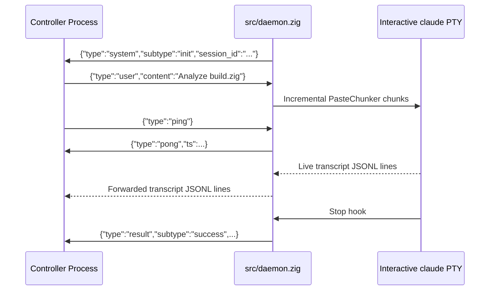

{/* Generated from .smithers/wiki/pages/daemon-protocol.md by .smithers/flows/wiki/sync-wiki.mjs. Edit the source wiki page instead. */}

## Stdin and Stdout Framing

`claude-p daemon --output-format stream-json --verbose` keeps one interactive Claude Code PTY alive across multiple turns. Daemon mode rejects `--output-format text` and `--output-format json`.

- **Inbound frames (stdin NDJSON):** `user`, `ping`, `interrupt`. Blank lines are ignored silently. Queue capacity is bounded at 64 prompts and 64 MiB.
- **Outbound protocol rejections:** Non-turn errors (`invalid_json`, `unsupported_frame_type`, `invalid_user_message`, `unsupported_content_block`, `stdin_line_too_large`, `fifo_line_too_large`, `queue_full`) emit `{"type":"error","error":"<reason>"}`.
- **Outbound turn and session results:** `type:"result"` is reserved strictly for turn-ending and session-ending frames (including `claude_not_found`, `spawn_failed`, `permission_prompt_blocked`, `stop_failure`, and watchdog timeouts).

## Responsiveness and Dual Watchdogs

1. **Incremental paste:** `PendingPaste` in `src/daemon.zig` writes one `PasteChunker` chunk per loop tick instead of blocking, so `ping` replies within milliseconds and `interrupt` can abort mid-paste.
2. **Dual watchdogs:** Independent idle-PTY (`--idle-timeout`) and transcript-stall (`--transcript-idle-timeout`) watchdogs monitor `.busy` turns only (never tripping while `.idle`) and exit `124` on stall.
3. **PTY trace gating:** `[pty-trace]` stderr diagnostics remain silent unless `--debug` or `CLAUDE_P_PTY_TRACE` is set.
4. **Shared startup logic:** `src/daemon.zig` delegates dialog handling, paste chunking, and env filtering to `src/driver.zig`.

## Related Wiki Pages

- [System Overview and World Model](/claude-p/wiki/)
- [Startup Dialog FSM and macOS TTYHOG Safe Paste](/claude-p/wiki/startup-dialogs-and-paste/)
- [Transcript Parsing, Resume Offset Isolation, and Stop Races](/claude-p/wiki/transcript-and-streaming/)

---

Source of truth: `.smithers/wiki/pages/daemon-protocol.md` · Tracked inputs: `src/daemon.zig`, `src/main.zig`, `src/emit.zig`
