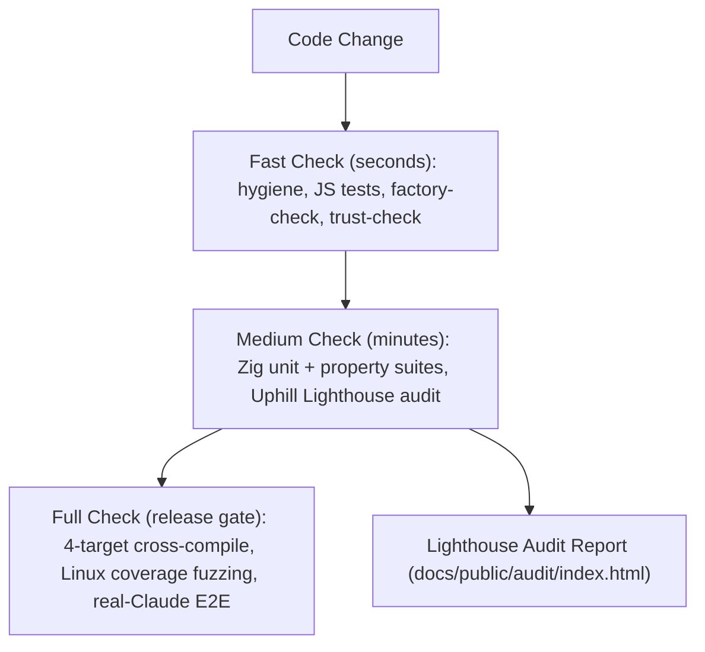

{/* Generated from .smithers/wiki/pages/fuzzing-and-verification.md by .smithers/flows/wiki/sync-wiki.mjs. Edit the source wiki page instead. */}

## Multi-Layer Verification Stack

1. **Zig unit tests (`src/*.zig`):** Inline tests checked with `std.testing.allocator` for zero leaks across every module.
2. **Property and fuzz-corpus suites (`tests/prop_fuzz.zig`):** 133 property and corpus-replay tests exercising `args`, `daemon`, `driver`, `emit`, `hook`, `stream`, `terminal`, and `transcript` with 31 `std.testing.fuzz` targets.
3. **Linux coverage-guided fuzzing (`scripts/fuzz-linux.sh`):** Compiles one SanCov-instrumented binary with Zig 0.15.2 LLVM backend and runs all 31 fuzz targets in parallel on Linux CI and bare-metal runners. Every fuzz callback guards against empty inputs to prevent Zig 0.15.2's upstream `lib/fuzzer.zig` empty-slot corpus bug while deterministic tests cover 0-byte and 1-byte inputs.
4. **Node supply-chain property suite (`tests/prop/js_supplychain_prop.mjs`):** 4,000+ randomized trials covering `SHA256SUMS` parsing, bit-flip tamper rejection, symlink staging attacks, gzip bombs, deadline enforcement, and signal forwarding.
5. **Real-Claude E2E (`tests/integration.zig`):** Zero mocks, run on demand via `CLAUDE_P_E2E=1` or `scripts/smthrs run //.smithers:test-e2e`.

## Uphill Lighthouse-Style Backpressure

`.agents/uphill/uphill.yaml` scores six categories against hard targets:
- **Footprint:** Module line counts, file sizes, and zero runtime npm deps.
- **Style and TigerStyle:** `zig fmt`, 120-column lines, function lengths, and `std.debug.assert` invariant density.
- **Correctness:** Version lockstep, script syntax, factory projection freshness, panic-free production Zig, and no silent `catch {}`.
- **Testing:** JS supply-chain tests, per-module unit test depth, and property/fuzz pairing.
- **Documentation:** `///` doc coverage on public Zig APIs, valid Markdown links, and Starlight frontmatter.
- **Factory and Trust:** Shared object store split, trust-boundary tests, personalized 3-audience home, wiki freshness, mythical history, and MCP sandbox auth.

`.smithers/audit/generate-lighthouse.mjs` renders the live interactive Lighthouse-style HTML and JSON report published at `https://smithersai.github.io/claude-p/audit/`.

## Related Wiki Pages

- [Supply-Chain Trust Root and Automated Releases](/claude-p/wiki/supply-chain-and-releases/)
- [Smithers Cloud Factory, Object Store, and Cloud MCP Auth](/claude-p/wiki/smithers-cloud-factory/)
- [Contributing, Public TODOs, and Untrusted Execution Policy](/claude-p/wiki/contributing-and-triage/)

---

Source of truth: `.smithers/wiki/pages/fuzzing-and-verification.md` · Tracked inputs: `tests/prop_fuzz.zig`, `tests/integration.zig`, `scripts/fuzz-linux.sh`, `.agents/uphill/uphill.yaml`
