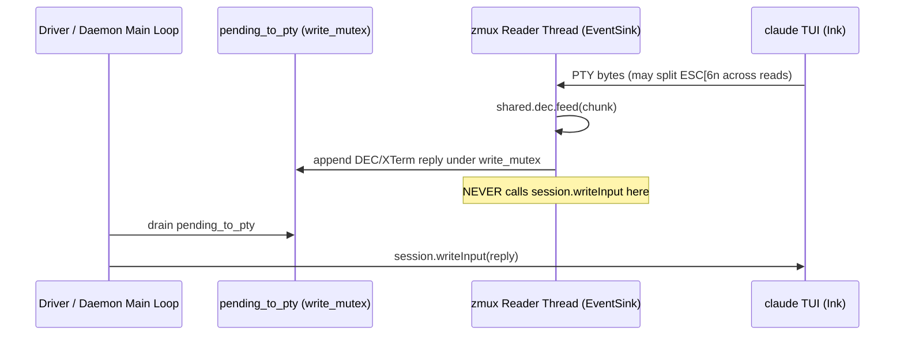

{/* Generated from .smithers/wiki/pages/pty-and-zmux.md by .smithers/flows/wiki/sync-wiki.mjs. Edit the source wiki page instead. */}

## Load-Bearing Threading Invariant

`zmux` delivers PTY output on a dedicated reader thread via `EventSink.onZmuxEvent`. Calling `session.writeInput` from inside that callback can re-enter `zmux` locks and deadlock. Both `src/driver.zig` and `src/daemon.zig` append terminal replies to `shared.pending_to_pty` under `shared.write_mutex` and flush them exclusively from the main event loop (`flushPendingToPty`).

## Stateful DEC and XTerm Decoding

Claude Code's Ink TUI probes terminal capabilities during boot and settle waits. If queries go unanswered, Ink blocks indefinitely before firing `SessionStart`.

`src/terminal.zig` implements a streaming `DecDecoder` state machine (`shared.dec`) that handles queries split across arbitrary PTY read boundaries:
- `DA1` (`CSI c` / `CSI 0 c`)
- `DA2` (`CSI > c` / `CSI > 0 c`)
- `DSR` (`CSI 6 n`)
- `XTVERSION` (`CSI > q` / `CSI > 0 q`)
- `XTWINOPS 18t` (`CSI 18 t`) returning the configured PTY rows and columns

Never substitute a stateless one-shot query scanner on a live PTY stream because split escape sequences will be dropped.

## Zig 0.15.2 and zmux Pin

`build.zig.zon` pins `zmux` (which enforces Zig `0.15.2` at comptime). Any update to the `zmux` dependency requires passing both the unit/property suite and `CLAUDE_P_E2E=1 sh .smithers/run-zig.sh build test-integration --summary all`.

## Related Wiki Pages

- [System Overview and World Model](/claude-p/wiki/)
- [Startup Dialog FSM and macOS TTYHOG Safe Paste](/claude-p/wiki/startup-dialogs-and-paste/)
- [Nonce-Tagged Hook Relay and Ephemeral FIFO](/claude-p/wiki/hook-relay-and-fifo/)

---

Source of truth: `.smithers/wiki/pages/pty-and-zmux.md` · Tracked inputs: `src/terminal.zig`, `src/driver.zig`, `build.zig.zon`
