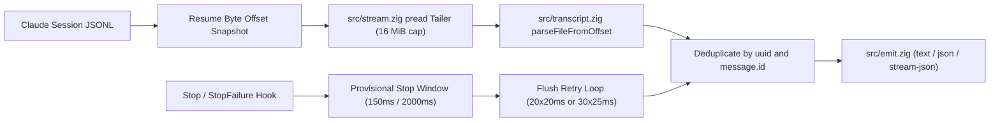

{/* Generated from .smithers/wiki/pages/transcript-and-streaming.md by .smithers/flows/wiki/sync-wiki.mjs. Edit the source wiki page instead. */}

## Resume Offset Isolation

When `--resume` or `--continue` is active, the session transcript file already contains prior turns. Re-parsing the whole file would duplicate historical assistant output and inflate token usage.

`src/driver.zig` and `src/daemon.zig` wait for restored UI quiescence (400 ms, capped at 6000 ms), snapshot `pre_prompt_transcript_offset`, and parse only appended bytes via `parseFileFromOffset` in `src/transcript.zig`.

## Deduplication and Stream Capping

- `src/transcript.zig` deduplicates transcript records by `uuid` and token usage records by `message.id` so multi-chunk streaming entries never double-count turns or tokens.
- `src/stream.zig` uses `pread`-based line buffering and discards any partial line exceeding 16 MiB to protect memory bounds.

## Provisional Stop and Flush Races

A `Stop` hook can fire before the final assistant record flushes to disk, or a user-registered `--extra-hook Stop=` can block continuation:
1. Both modes confirm immediately on a `stop_hook_summary` record with `preventedContinuation: false`, otherwise wait a fallback window (150 ms default, 2000 ms with `--extra-hook Stop=`).
2. A later `Stop` with `stop_hook_active: true`, `preventedContinuation: true`, or new assistant transcript bytes supersedes the provisional stop.
3. Once confirmed, a pump-and-parse loop retries up to 20 x 20 ms (one-shot) or 30 x 25 ms (daemon), exiting early when the transcript matches `Stop`'s `last_assistant_message` and falling back to that text if absent.
4. `StopFailure` parses the transcript first so token usage and turn counts are preserved, forces `is_error: true`, and attaches `"error":"stop_failure"` in daemon mode.

## Related Wiki Pages

- [Nonce-Tagged Hook Relay and Ephemeral FIFO](/claude-p/wiki/hook-relay-and-fifo/)
- [Multi-Turn NDJSON Daemon Protocol](/claude-p/wiki/daemon-protocol/)
- [Property Suites, Coverage-Guided Fuzzing, and Lighthouse Backpressure](/claude-p/wiki/fuzzing-and-verification/)

---

Source of truth: `.smithers/wiki/pages/transcript-and-streaming.md` · Tracked inputs: `src/transcript.zig`, `src/stream.zig`, `src/emit.zig`
